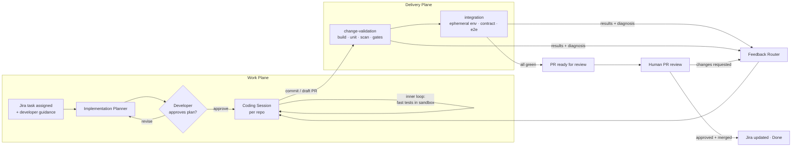

# agentic-pipeline

An event-driven, agentic development and build pipeline. A developer assigns a work item (e.g. a Jira task) and gives guidance. Agents propose an implementation plan, and **the developer approves it**. Agents then write code and tests across one or more repositories, and an event-driven pipeline builds, tests and integration-tests every commit, feeding structured results back to the agents until the change is ready for human review.

Status: **working demo, design continuing.** The full design is in [`docs/`](docs/README.md). A thin vertical slice (demo phases P1–P4) is implemented in Go and TypeScript and has run one card end to end against two real GitHub repos. See [Implementation Status](docs/16-implementation-status.md) for what is built and what is still design only.

## The process

The developer is involved at three points: assign and guide, **approve the plan**, and review the PR. Everything else is agents and events. There are two loops. The **inner loop** is fast, non-authoritative tests inside the agent's sandbox. The **outer loop** is the full delivery pipeline on every push, with structured feedback sent back to the same coding session.



Inside each coding session, a separate **Test Author** agent writes tests from the acceptance criteria first. A **Coding agent** then implements until those tests pass. Agents never push. They emit proposals, and a host-side **Scope Guard** and **Applier** check each one against the approved plan's scope envelope before committing. Details: [14 — Work Plane](docs/14-work-plane.md), [15 — Integration Testing](docs/15-integration-testing.md), [02 — Architecture Overview](docs/02-architecture-overview.md).

In the demo, a local card file stands in for Jira, GitHub Actions is the delivery plane, and a SQLite event log replaces the bus. See [the demo doc](docs/demo/README.md).

## Quick start (demo)

```bash
go build -o bin/ap ./cmd/ap
docker build -t ap-sandbox:node24 -f sandbox/Dockerfile .
export ANTHROPIC_API_KEY=...             # or AP_AGENT_AUTH=claude-login

./bin/ap card submit demo/cards/DEMO-1.json
./bin/ap serve &                         # dispatcher + GitHub poller
./bin/ap plan show DEMO-1
./bin/ap approve DEMO-1                  # sponsor only; starts the coding sessions
./bin/ap status DEMO-1
./bin/ap timeline DEMO-1                 # the full correlated event tree
```

The full runbook is in [docs/demo/README.md §10](docs/demo/README.md#10-running-it).

## Repository layout

```
cmd/ap/        CLI: serve, card, plan, approve/revise/reject/cancel, status, timeline, events, feed
internal/      event core, work items + planning, coding sessions + feedback, GitHub, agent gateway, feed
runner/        TypeScript agent runner (Claude Agent SDK), runs inside the sandbox
sandbox/       Dockerfile for the agent sandbox image (node 24 + git + runner)
demo/          demo config, event catalog subset, cards, fixtures
docs/          design docs, ADRs, event catalogs, schemas, demo plan
```
