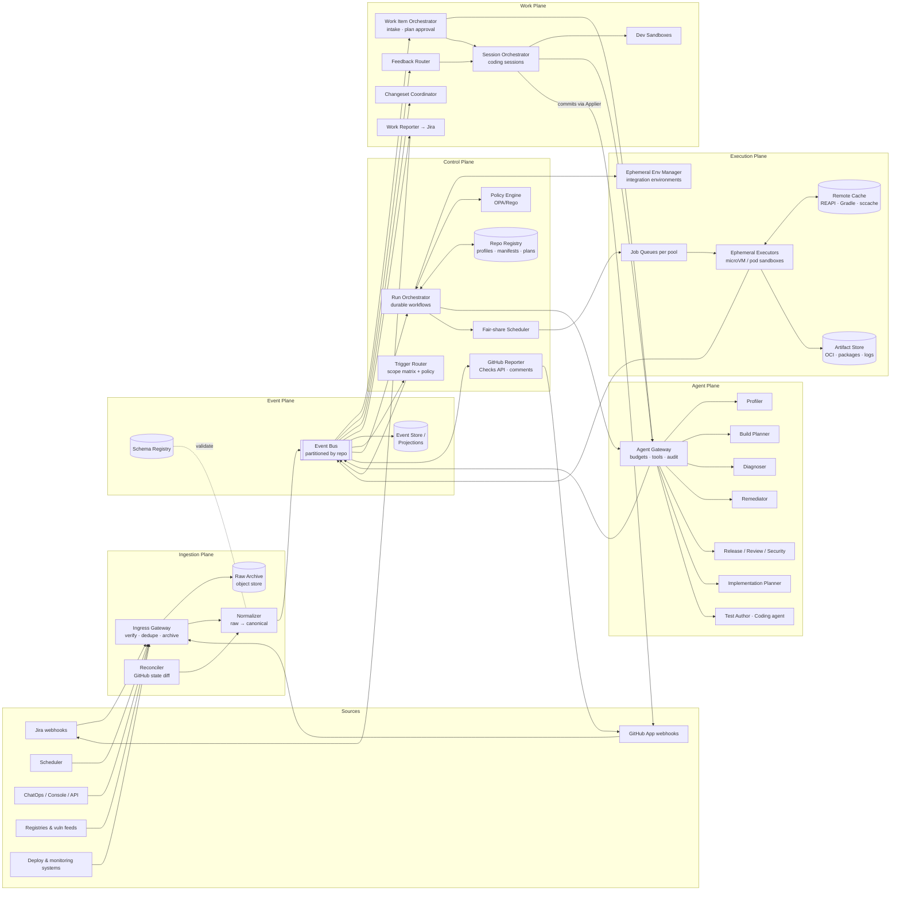
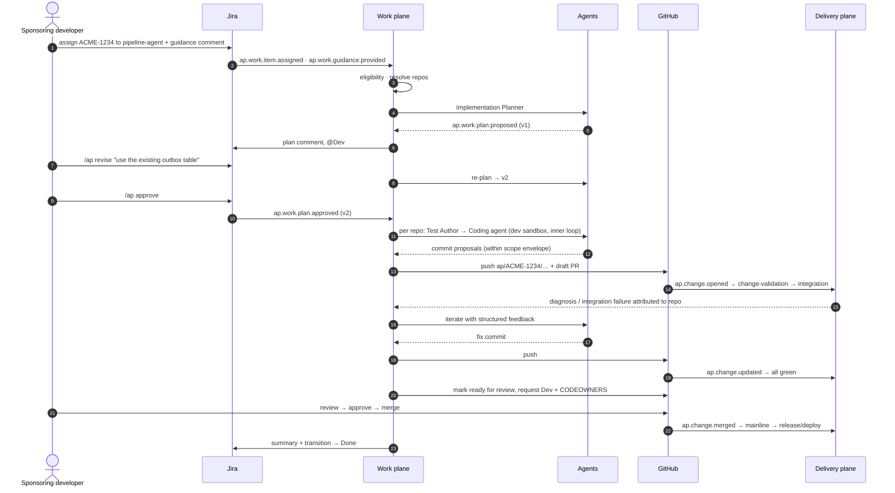
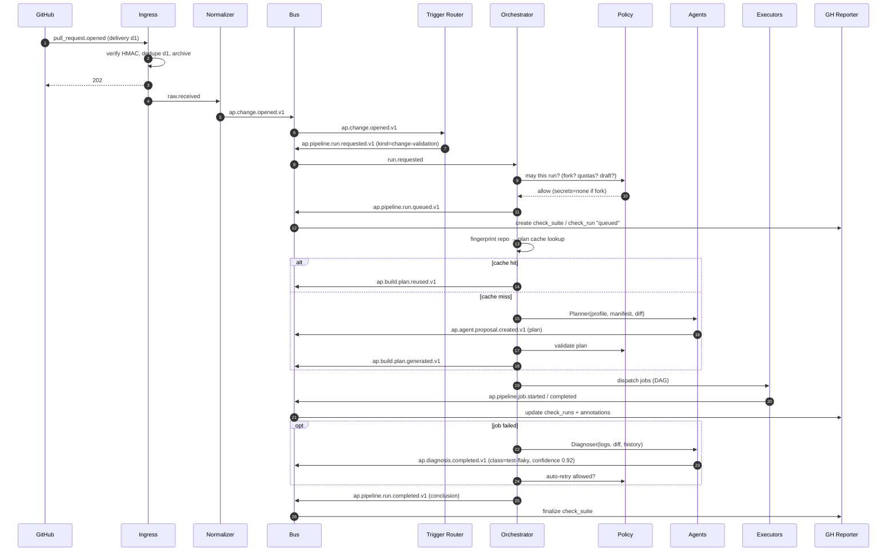

# 02 — Architecture Overview

## 1. Design principles

1. **Events are facts; commands are requests.** Facts (`…opened`, `…completed`) are immutable and past tense. Intents (`…requested`) can be rejected. We never mix the two.
2. **Deterministic core, agentic edges.** Routing, scheduling, policy, state machines and GitHub status reporting are deterministic code. Agents generate plans, diagnoses and proposals. Agents never hold the pen on state transitions.
3. **Agents propose, policy disposes.** Every agent output is a `proposal` event. A policy engine and the repo's autonomy level decide whether a proposal is auto-applied, sent for approval or discarded.
4. **Plan once, execute many.** The expensive reasoning ("how do I build this repo?") is cached as a Build Plan keyed by a repo fingerprint. Ordinary pushes reuse the plan with no LLM call.
5. **At-least-once delivery, idempotent consumers.** Exactly-once is a property of consumers (dedupe keys), not of the bus.
6. **The raw archive is the source of truth for ingestion.** We can always re-normalise from raw if a mapping was wrong.
7. **Tenancy is in the envelope.** Every event carries `tenant`, `team` and `repo`. Isolation, quotas and routing key off envelope fields, never off payload parsing.
8. **Humans approve intent; agents do the work; the pipeline verifies.** A developer approves *what* will be built (the implementation plan). Agents produce code and tests within that approved scope. The delivery pipeline (not the agent) decides whether the result is correct. A human makes the merge decision.
9. **Agent changes get no shortcut.** Agent-authored commits enter the delivery plane as ordinary `ap.change.*` events and go through the same gates, plus mandatory integration testing.
10. **Feedback is structured and routed to its owner.** Pipeline results reach the coding session that owns the change as typed events with locations and evidence, never as raw logs.

## 2. Planes

### 2.0 Work plane (see [14](14-work-plane.md))
- **Work Item Orchestrator.** One durable workflow per Jira task. It handles intake, eligibility, repo resolution, clarifications, implementation planning and **developer plan approval**, then tracks the item to completion.
- **Session Orchestrator.** One durable workflow per (work item, repo) coding session. It provisions a dev sandbox, runs the Test Author and Coding agents, applies their commits through the Applier, enforces the approved scope envelope and budgets, and iterates on feedback.
- **Dev Sandboxes.** Long-lived (hours), interactive, isolated environments with a writable checkout and the repo's toolchain (from the Build Plan). They hold no production secrets and use a restricted egress profile. They are separate from the single-use build executors.
- **Feedback Router.** Sends pipeline diagnoses, integration failures and review comments on agent-owned changes to the owning session.
- **Changeset Coordinator.** Groups multi-repo changes for one task, triggers joint integration, and controls merge order.
- **Work Reporter.** The only writer to Jira: comments, transitions, remote links.

### 2.1 Ingestion plane
- **Ingress Gateway.** Stateless HTTP endpoint behind a load balancer. It verifies the HMAC signature, enforces size limits, writes the raw payload and headers to the **Raw Archive**, records the delivery ID in a dedupe store (TTL ≥ 7 days), and returns `202` *only after* the durable write. Its target is to respond well inside GitHub's 10-second timeout, at ≤ 200 ms p99.
- **Normalizer.** Consumes the raw stream and applies versioned mapping rules ([05](05-source-mappings.md)) to emit 0..n canonical events per raw event. A raw event that maps to nothing is recorded as `ignored`, with a reason, for scope auditing.
- **Reconciler.** Periodically (and on demand) lists GitHub state for installed repos: branch heads, open PRs, pending merge-group entries. It compares that with projections and emits synthetic canonical events marked `ap.origin=reconciler` for anything missed. Webhooks *will* be lost, so this is the safety net.

### 2.2 Event plane
- **Event Bus.** A durable, ordered-per-partition log. The partition key is `repo` (with `subject` sub-ordering where needed), so all events for one repo are totally ordered. See [ADR-0002](adr/0002-event-bus.md).
- **Schema Registry.** JSON Schema per `type`. Publishing is validated, and compatibility checks run in CI.
- **Event Store / Projections.** Long-term storage, plus read models: change timeline, run state, repo health, DORA metrics, cost.

### 2.3 Control plane
- **Trigger Router.** A pure function: `(canonical event, repo config, policy) → 0..n intents`. Stateless. It implements the scope matrix ([06 §4](06-pipeline-lifecycle.md#4-scope-matrix-trigger--pipeline)).
- **Run Orchestrator.** One durable workflow per pipeline run ([ADR-0003](adr/0003-durable-workflows.md)). It owns the run state machine, calls agents through the Agent Gateway, asks the Policy Engine at every gate, and dispatches jobs to the scheduler. It survives restarts and handles timeouts, retries, supersession and compensation.
- **Policy Engine.** OPA/Rego bundles: org baseline, then team overlay, then repo overlay. Decisions are logged as events.
- **Fair-share Scheduler.** Weighted fair queuing across tenants, priority classes and executor pools (e.g. `linux-amd64-large`, `linux-arm64`, `macos`, `gpu`).
- **Repo Registry.** Repo metadata, ownership, profile, manifest, cached Build Plans and their fingerprints.
- **GitHub Reporter.** The only component that writes to GitHub status surfaces (Checks API, PR comments, commit statuses). It consumes outcome events, keeps GitHub in sync, and handles rate limits and installation tokens centrally.

### 2.4 Agent plane
- **Agent Gateway.** The single entry point to every LLM-backed agent. It enforces per-tenant token and cost budgets, gives each agent a scoped tool set, injects context safely (repo content marked untrusted), records full traces, and emits `ap.agent.*` events. See [07](07-agents.md).

### 2.5 Execution plane
- **Executors.** Ephemeral, single-use sandboxes (Firecracker / Kata microVMs, or gVisor pods for lower-trust work). Each job gets a fresh environment, a short-lived workload identity (OIDC) and an egress policy. Executors stream logs to the artifact store and emit job events.
- **Remote cache.** Bazel REAPI / BuildBuddy-style CAS, Gradle build cache, sccache, Turborepo/Nx remote cache, and language package proxies (npm, PyPI, Maven, Go module proxy, crates). Caches are tenant-scoped.
- **Artifact store.** An OCI registry for images and generic artifacts (ORAS), package registries, a log store, and attestations (in-toto / Sigstore).

## 3. End-to-end flows

### 3.1 Jira task → merged change (primary flow)

### 3.2 Delivery-plane detail: PR opened

## 4. Technology stance (proposed, see ADRs)

| Concern | Proposed choice | Alternatives considered |
|---------|-----------------|-------------------------|
| Envelope | CloudEvents 1.0 (structured JSON) | Custom envelope, Avro-only |
| Bus | Kafka-compatible log (Redpanda or MSK) | NATS JetStream, Pulsar, cloud pub/sub |
| Orchestration | Temporal | Argo Workflows, Step Functions, home-grown sagas |
| Policy | OPA / Rego | Cedar, hard-coded rules |
| Sandboxes | Firecracker microVMs (via Kubernetes + Kata), gVisor for low-trust | Plain containers (rejected for untrusted code) |
| Cache | REAPI-compatible CAS + per-ecosystem caches | — |
| Signing / provenance | Sigstore (cosign, Fulcio, Rekor), SLSA v1.0 provenance, CycloneDX / SPDX SBOM | — |
| Observability | OpenTelemetry (traces, metrics, logs), trace per change | — |
| SCM integration | GitHub App (installation tokens, Checks API) | OAuth app, PATs (rejected) |
| Work tracker integration | Jira Cloud app (Forge/Connect) with webhooks + OAuth 2.0 write-back | Admin webhooks + API token (fallback) |
| Dev sandboxes | microVMs with persistent volume for session duration | Shared dev containers (rejected: isolation) |
| Integration environments | Kubernetes namespace per environment, baseline + overlay routing via service mesh, database branching for data | Full stack per PR (allowed per system) |
