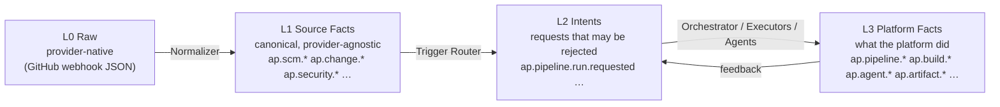
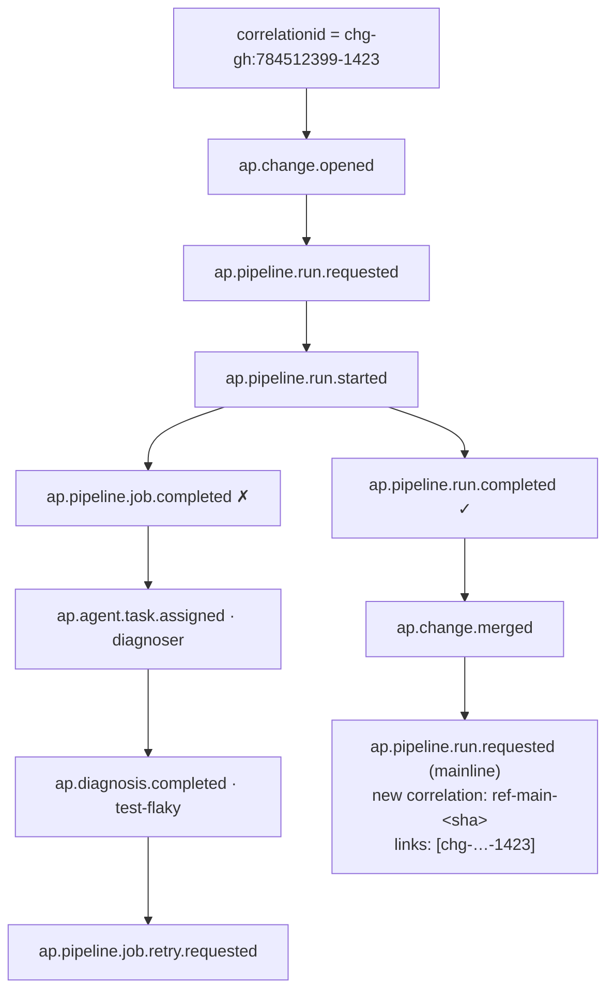

# 03 — Event Model

> The event model defines the scope of the pipeline. A stimulus that has no canonical event cannot trigger anything. An outcome that has no canonical event did not, for platform purposes, happen.

## 1. Why the event model comes first

With dozens of teams and thousands of repos, the realistic risk is not "we can't build X". It is "nobody knows what the pipeline actually reacts to". GitHub alone exposes 70+ webhook event types with hundreds of `action` variants. Teams will ask for "just one more trigger". The event model keeps that under control by forcing every behaviour through three questions:

1. **Which canonical event represents this stimulus?** If there isn't one, adding it is a reviewed change to the catalog.
2. **Which intents does the Trigger Router derive from it?** This is the scope matrix.
3. **Which outcome events prove what happened?** These drive audit, metrics and GitHub status.

## 2. Event layers

Events move through four layers. Each layer has a different owner, schema discipline and retention.



| Layer | Nature | Examples | Schema discipline | Retention |
|-------|--------|----------|-------------------|-----------|
| **L0 Raw** | Provider payload, unchanged | GitHub `pull_request` webhook | None (provider-owned). Stored with headers. | 90 d hot, 1 y cold |
| **L1 Source facts** | Things that happened *outside* the platform, normalised | `ap.change.opened.v1`, `ap.scm.ref.updated.v1` | Strict, registry-validated | 1 y+ |
| **L2 Intents** | Requests for the platform to do something | `ap.pipeline.run.requested.v1`, `ap.command.received.v1` | Strict | 1 y+ |
| **L3 Platform facts** | Things the platform did or decided | `ap.pipeline.run.completed.v1`, `ap.agent.proposal.created.v1`, `ap.policy.decision.recorded.v1` | Strict | 1 y+ (audit) |

**Rules**
- L1 events are **provider-agnostic**. A GitLab merge request and a GitHub pull request both become `ap.change.*`. Provider specifics go in `data.provider` and are not used for routing.
- Only the **Trigger Router**, the **API** and **agents through the gateway** may emit L2 intents.
- Only the component that owns an aggregate may emit L3 facts about it. For example, only the Orchestrator emits `ap.pipeline.run.*`.

## 3. Event classes

Every event type is exactly one of:

| Class | Tense | Can be rejected? | Example |
|-------|-------|------------------|---------|
| **Fact** | Past (`opened`, `completed`) | No, it already happened | `ap.pipeline.job.completed.v1` |
| **Intent** | `requested` / `received` | Yes. It must be answered by an `accepted`/`rejected` fact or a downstream fact. | `ap.pipeline.run.requested.v1` |
| **Signal** | Present (`detected`, `degraded`) | No. Advisory, may be noisy. | `ap.environment.health.degraded.v1` |

## 4. Envelope

We use **CloudEvents 1.0**, structured JSON mode, plus platform extension attributes. JSON Schema: [`schemas/envelope.schema.json`](schemas/envelope.schema.json).

### 4.1 Required attributes

| Attribute | Source | Description |
|-----------|--------|-------------|
| `specversion` | CE | `"1.0"` |
| `id` | CE | UUIDv7 (time-ordered). Unique per event. |
| `source` | CE | URI reference of the producer, e.g. `//github.com/acme/payments-api`, `//ap/orchestrator`, `//ap/agents/diagnoser` |
| `type` | CE | `ap.<domain>.<entity>.<verb>.v<major>`, see §5 |
| `time` | CE | RFC 3339 time *the fact occurred* (not time of publish) |
| `subject` | CE | The aggregate the event is about, e.g. `change/1423`, `run/01J…`, `ref/refs/heads/main` |
| `datacontenttype` | CE | `application/json` |
| `dataschema` | CE | Registry URI of the payload schema |
| `tenant` | ext | Organisation / installation scope (isolation boundary) |
| `team` | ext | Owning team slug (from the Repo Registry). `_unowned` if unknown. |
| `repo` | ext | Stable repo ID (`gh:123456789`). **Never the name**, because names change. |
| `partitionkey` | ext (CE partitioning) | Normally equal to `repo`. Defines the ordering scope. |
| `correlationid` | ext | Ties together everything stemming from one root stimulus (normally one change or one release) |
| `causationid` | ext | `id` of the event that directly caused this one (empty for L1) |
| `traceparent` | ext (CE distributed tracing) | W3C trace context |

### 4.2 Optional attributes

| Attribute | Description |
|-----------|-------------|
| `origin` | `webhook` · `reconciler` · `replay` · `api` · `scheduler` · `agent` · `synthetic-test` |
| `actor` | `{kind: human|bot|agent|system, id, login}`, the identity on whose behalf this happened |
| `sensitivity` | `public` · `internal` · `confidential`. Drives log redaction and agent context eligibility. |
| `sequence` | Monotonic per `subject`, set by the aggregate owner (L3 only) |
| `providerdelivery` | Original delivery ID (e.g. `X-GitHub-Delivery`) for L1 |
| `expiresat` | For intents: the time after which the intent is void (e.g. a stale retry request) |

### 4.3 Example

```json
{
  "specversion": "1.0",
  "id": "01933f6e-7b7a-7c2e-9a51-1f9a7f0c2b11",
  "source": "//github.com/acme/payments-api",
  "type": "ap.change.opened.v1",
  "subject": "change/1423",
  "time": "2026-11-20T10:14:03Z",
  "datacontenttype": "application/json",
  "dataschema": "ap://schemas/ap.change.opened/1.2.0",
  "tenant": "acme",
  "team": "payments",
  "repo": "gh:784512399",
  "partitionkey": "gh:784512399",
  "correlationid": "chg-gh:784512399-1423",
  "causationid": "",
  "traceparent": "00-4bf92f3577b34da6a3ce929d0e0e4736-00f067aa0ba902b7-01",
  "origin": "webhook",
  "providerdelivery": "72d3162e-cc78-11e3-81ab-4c9367dc0958",
  "actor": { "kind": "human", "id": "gh-user:5521", "login": "jdoe" },
  "sensitivity": "internal",
  "data": {
    "change": { "number": 1423, "title": "Add idempotency keys to refunds", "draft": false },
    "head": { "ref": "feature/idem-keys", "sha": "9f1c…", "repo": "gh:784512399" },
    "base": { "ref": "main", "sha": "a07e…" },
    "isFork": false,
    "labels": ["payments", "risk:medium"],
    "provider": { "name": "github", "nodeId": "PR_kwDO…", "url": "https://github.com/acme/payments-api/pull/1423" }
  }
}
```

More examples are in [`schemas/examples/`](schemas/examples/).

## 5. Naming conventions

```
ap.<domain>.<entity>[.<sub-entity>].<verb>.v<major>
```

- `domain` is one of the bounded contexts in §6.
- `verb` is **past tense** for facts (`opened`, `completed`, `superseded`), `requested`/`received` for intents, and present participle or adjective for signals (`detected`, `degraded`).
- **The major version is in the type.** A breaking change creates a new type (`…v2`) that is published in parallel with `…v1` until every consumer has migrated. Minor and patch versions are carried in `dataschema` and must be backward compatible (additive and optional only).
- No provider names in types (`ap.change.opened`, not `ap.github.pr.opened`). The exception is the `ap.raw.*` L0 envelope.
- Outcomes use a single `completed` event with `data.conclusion`, not separate `succeeded`/`failed` types. Conclusions are `success | failure | cancelled | skipped | timed_out | neutral | action_required`, aligned with GitHub Checks conclusions so the Reporter can map them 1:1.

## 6. Bounded contexts (domains)

| Domain | Owns | Primary producer | Notes |
|--------|------|------------------|-------|
| `raw` | Unchanged provider deliveries | Ingress | L0 only; one type per provider |
| `work` | Work items (Jira tasks), guidance, clarifications, implementation plans, approval | Normalizer (Jira), Work Item Orchestrator | **Work plane root.** See [14](14-work-plane.md). |
| `devsession` | Coding sessions: commits, iterations, feedback, blocking | Session Orchestrator | One per (work item, repo) |
| `changeset` | Multi-repo groupings of changes for one work item | Changeset Coordinator | Joint integration, merge order |
| `integration` | Integration suites, data seeding, failure attribution | Integration runner, Attributor | See [15](15-integration-testing.md) |
| `tenant` | Installations, teams, ownership | Normalizer, Registry | GitHub App `installation*` events |
| `repo` | Repo lifecycle, profile, manifest | Normalizer, Profiler | Rename, transfer, archive, visibility |
| `scm` | Refs: branches, tags, pushes | Normalizer | Non-PR source changes |
| `change` | PRs / MRs and their reviews | Normalizer | The unit most pipelines hang off |
| `mergequeue` | Merge-queue entries | Normalizer | GitHub `merge_group` |
| `command` | Human or bot instructions | Normalizer, API | ChatOps, console, API, re-run buttons |
| `schedule` | Time-based triggers | Scheduler | Nightly, weekly, cron from manifest |
| `pipeline` | Runs, stages, jobs | Orchestrator, Executors | Core execution aggregate |
| `build` | Build plans and fingerprints | Orchestrator, Planner | Plan lifecycle and cache |
| `test` | Test results, flakes, quarantine | Executors, Diagnoser | Fine-grained quality data |
| `diagnosis` | Failure analyses | Diagnoser | Classification plus evidence |
| `artifact` | Built outputs, signatures, SBOM, provenance | Executors, Signer | Supply-chain facts |
| `gate` / `policy` | Gate evaluations and policy decisions | Policy Engine | Every allow/deny is an event |
| `approval` | Human approvals | Orchestrator, Normalizer | Reviews, deployment protection rules, console |
| `release` | Versions, tags, release notes | Release agent, Orchestrator | |
| `deployment` | Deploy intents and outcomes per environment | Orchestrator, external CD | We may or may not execute deploys |
| `environment` | Runtime health signals; ephemeral integration environments (`environment.ephemeral.*`) | Monitoring adapters, Ephemeral Env Manager | Feeds rollback, change-failure-rate, integration |
| `dependency` | Upstream releases, update proposals | Feeds, Dependency agent | |
| `security` | Vulnerability, secret and code-scanning alerts | Normalizer, scanners | |
| `agent` | Agent tasks, proposals, escalations, budgets | Agent Gateway | All agent activity |
| `executor` | Runner and pool lifecycle | Execution plane | Capacity and lost-job detection |
| `notification` | Outbound human notifications | Notifier | For audit of who was told what |
| `extci` | Observed runs from *other* CI systems | Normalizer | Coexistence / migration mode |

The full list of types is in the [Event Catalog](04-event-catalog.md).

## 7. Delivery semantics

| Property | Guarantee | Mechanism |
|----------|-----------|-----------|
| Ingress durability | Accepted ⇒ never lost | `202` only after the raw archive write *and* bus publish (or transactional outbox) |
| Bus delivery | At-least-once | Consumer offsets are committed after the side effect |
| Ordering | Total order **per partition key (repo)**. No global order. | Partition by `repo` |
| Duplicates | Expected | Every consumer is idempotent on `id` (L1–L3) or `providerdelivery` (L0 → L1) |
| Exactly-once effects | Per consumer | Dedupe table plus idempotency keys on external calls (e.g. Checks API `external_id`) |
| Poison events | Isolated | Retry with backoff, then a per-consumer DLQ (`ap.dlq.<consumer>`), alert, and replay tooling |

### 7.1 Ordering is not causality

Webhooks arrive out of order. GitHub may deliver `pull_request.synchronize` for SHA B before `push` for SHA B, or redeliver an old event hours later. Consumers **must not** assume arrival order reflects reality. Instead:

- **Compare by content, not arrival.** A run for `headSha` X is superseded only by an event whose head is a descendant of X, or by a later `time` on the same `subject` for force-pushes.
- **Aggregate owners assign `sequence`.** For L3 facts, `sequence` per `subject` is authoritative.
- **Late or stale L1 events** (`time` older than the aggregate's last known state) are recorded and flagged `stale=true` in projections. They never regress state.

### 7.2 Idempotency keys

| Effect | Idempotency key |
|--------|-----------------|
| Normalise raw → canonical | `providerdelivery` + mapping version |
| Request a run | `hash(repo, pipelineKind, subject, headSha, triggerEventId)` |
| Dispatch a job | `runId` + `jobKey` + `attempt` |
| Create a GitHub check run | `external_id = runId/jobKey` |
| Agent proposal application | `proposalId` |
| Artifact publish | content digest |

## 8. Correlation model



- **Work items are the top-level root.** An agent-driven task mints `wi-<tenant>-<ISSUE-KEY>`, and every plan, session, changeset, environment and agent task carries it. Changes opened by a session carry their own `chg-…` correlation, with `data.links: ["wi-…"]`, so the full tree is Jira task → plan → sessions → changes → runs → integration → merge → deploy.
- `correlationid` scopes **a change's journey**. Root stimuli mint one: a change uses `chg-<repo>-<number>`, a mainline push `ref-<repo>-<ref>-<sha>`, a release `rel-<repo>-<version>`, a schedule `sch-<repo>-<scheduleId>-<firedAt>`.
- When one journey hands off to another (merge → mainline build → release → deploy), the new event carries `data.links[]` back to the previous correlation IDs. This gives **commit-to-production lineage** for DORA lead time.
- `causationid` forms an exact DAG, so the console can render "why did this happen?" chains.

## 9. Scope control

The event model enforces scope in three ways:

1. **Catalog gate.** New `type`s are added by PR to the schema registry repo, with a named owner, producer, consumers and a scope-matrix entry. Without a catalog entry, the bus rejects the publish.
2. **Ignored-event ledger.** Every L0 event that maps to no L1 event is counted by `(provider, eventType, action, reason)`. This shows what teams are doing that the platform deliberately ignores, which is the backlog of scope decisions.
3. **Interest registry.** Repos can only *subscribe* to catalog events, through the manifest. They cannot invent triggers. Custom behaviour attaches to canonical events with `on:` filters (see [08](08-repository-contract.md)).

## 10. Schema evolution

- Schemas live in a dedicated repo (`ap-event-schemas`). CI runs compatibility checks (no removal or renaming of fields, and no new required fields within a major).
- Producers embed the full semver in `dataschema`. Consumers declare the minimum minor they need.
- Deprecation: a `…v1` type stays published for ≥ 90 days after `…v2` reaches GA. Consumer lag per type version is visible on dashboards.
- Payloads should be **self-sufficient for routing** but **reference-heavy for bulk data**. Logs, diffs, SARIF and test reports are stored in the artifact store and referenced by URI and digest, never inlined. Event size limit: **64 KiB**.

## 11. Payload conventions

- IDs: `gh:<numeric>` for provider objects, UUIDv7 / ULID for platform objects (`run_01J…`).
- Git objects: always the **full 40-character SHA** (or 64 for SHA-256 repos). Never a short SHA.
- Refs: fully qualified (`refs/heads/main`, `refs/tags/v1.2.3`).
- Times: RFC 3339 UTC.
- Money / cost: `{ "amount": "0.0421", "currency": "USD" }` as a decimal string.
- Bulk references: `{ "uri": "ap-art://…", "digest": "sha256:…", "mediaType": "…", "size": 12345 }`.
- PII: no emails or real names in payloads. Use stable IDs and logins only. Commit-author emails stay in L0 only.
