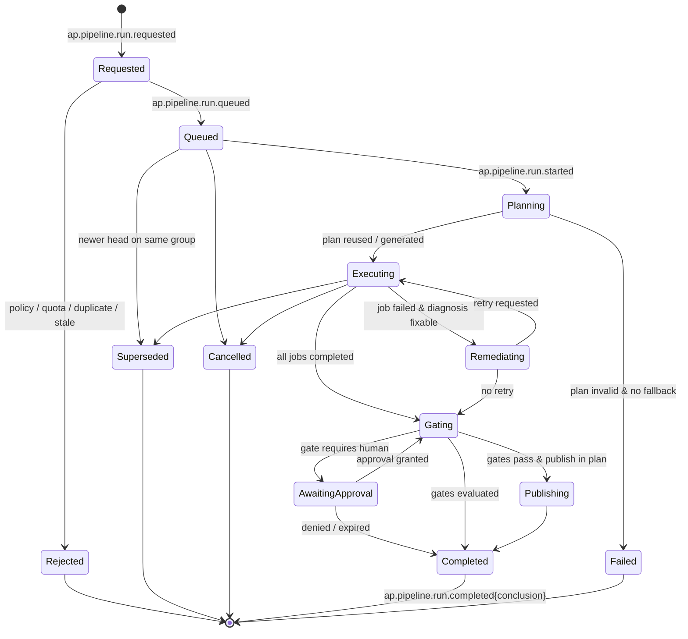

# 06 — Pipeline Lifecycle

## 1. Aggregates

| Aggregate | Identity | Owner | Lifetime |
|-----------|----------|-------|----------|
| Work item | `wi-<tenant>-<ISSUE-KEY>` | Work Item Orchestrator | assigned → done/cancelled ([14 §3](14-work-plane.md#3-work-item-lifecycle)) |
| Implementation plan | `planId@version` | Work Item Orchestrator | proposed → approved/rejected/superseded |
| Coding session | `sessionId` (work item × repo) | Session Orchestrator | requested → completed |
| Changeset | `changesetId` | Changeset Coordinator | created → merged |
| Ephemeral environment | `envId` | Ephemeral Env Manager | requested → torn down |
| Change | `repo + change number` | Normalizer (facts) / projections | PR open → merged/closed |
| Run | `runId` | Run Orchestrator | requested → completed |
| Job | `runId/jobKey/attempt` | Orchestrator + Executor | scheduled → completed |
| Plan | `planId` (keyed by `fingerprint`) | Plan Resolver | generated → invalidated |
| Proposal | `proposalId` | Agent Gateway → Gatekeeper | created → applied/discarded |
| Release | `repo + version` | Release Coordinator | requested → published |
| Deployment | `deploymentId` | Deployment Coordinator | requested → completed/rolled back |

## 2. Run state machine

## 3. Pipeline kinds

| `pipelineKind` | Purpose | Typical stages | Priority |
|----------------|---------|----------------|----------|
| `change-validation` | Validate a PR head (merge ref) | plan → build → test (impact-selected) → scan → gate | p2 |
| `integration` | Deploy the change's artifacts to an ephemeral environment and run integration / contract / e2e-smoke suites ([15](15-integration-testing.md)) | env provision → seed → suites → attribute → teardown | p2 (p1 for agent changes awaiting review) |
| `changeset-integration` | Integration-test all member changes of a multi-repo work item together | as `integration`, with all members' artifacts | p2 |
| `merge-queue` | Validate a speculative merge in the queue | full build + test (no impact selection) → gate | p1 |
| `mainline` | Build the default branch after a merge | build → full test → scan → package → sign → publish (snapshot) | p1 |
| `release` | Produce versioned, signed artifacts | version → build → package → SBOM → provenance → sign → publish → release notes | p1 |
| `deploy` | Promote artifacts through environments | approval? → deploy → verify → promote | p1 |
| `hotfix` | Expedited release on a release branch | release flow with p0 priority | p0 |
| `downstream-compat` | Test dependents against a new internal package | build + test against new version | p3 |
| `dependency-update` | Validate a dependency bump PR | change-validation + upgrade-specific checks | p3 |
| `security-remediation` | Remediate a vulnerability alert | agent proposal → change-validation | p2 |
| `nightly` / `scheduled` | Full test suites, flake hunts, cache warm-ups | full matrix | p4 |
| `reprofile` | Re-run the Profiler (no build) | profile → plan | p4 |
| `bisect` | Find the commit that broke mainline | partial builds over a commit range | p1 |

## 4. Scope matrix (trigger → pipeline)

This is the Trigger Router's default rule table. Repos can **narrow** it through the manifest. They can **widen** it only within the catalog and policy.

| Canonical event | Condition | → Intent / pipelineKind | Concurrency group | Supersedes? |
|-----------------|-----------|-------------------------|-------------------|-------------|
| **Work plane** | | | | |
| `ap.work.item.assigned{toAgent}` / `ap.command.accepted{start}` | project enabled | `ap.work.request.received` | `wi:<key>` | — |
| `ap.work.request.accepted` | — | `ap.work.plan.requested` (Implementation Planner) | `wi:<key>` | — |
| `ap.work.plan.revision.requested` | — | `ap.work.plan.requested{version+1}` | `wi:<key>` | ✓ pending plan |
| `ap.work.plan.approved` | — | `ap.devsession.requested` × repos (+ `ap.changeset.created` if > 1 repo) | `ses:<key>:<repo>` | — |
| `ap.work.item.updated{acceptanceCriteria/description}` | plan approved | `ap.work.plan.superseded` → sessions pause → re-plan | `wi:<key>` | ✓ |
| `ap.work.item.unassigned` / `deleted` / `ap.work.plan.rejected` | — | `ap.work.cancelled` → cancel sessions, environments | — | — |
| `ap.change.opened/updated` | `agentAuthored` (draft) | `change-validation` (**draft builds forced on**) | `chg:<repo>:<n>` | ✓ |
| `ap.pipeline.run.completed{change-validation, success}` | repo has `integration:` and (agent-authored or `requiredFor` matches) | `integration` | `int:<repo>:<n>` | ✓ older heads |
| `ap.changeset.ready` | — | `changeset-integration` | `csi:<changesetId>` | ✓ |
| `ap.diagnosis.completed`, `ap.integration.failure.attributed`, `ap.gate.evaluated{fail}`, `ap.change.review.submitted{changes_requested}` | change owned by an active session | `ap.devsession.feedback.received` (Feedback Router) | `ses:<key>:<repo>` | — |
| all checks + integration green on an agent change | session active | `ap.devsession.ready_for_review` → PR ready, reviewers requested | — | — |
| `ap.change.merged` | agent change | `ap.changeset.member.updated` / `ap.work.completed` when all merged | — | — |
| **Delivery plane** | | | | |
| `ap.change.opened` / `reopened` / `ready_for_review` | not draft (or `draftBuilds: true`) | `change-validation` | `chg:<repo>:<n>` | — |
| `ap.change.updated` | — | `change-validation` | `chg:<repo>:<n>` | ✓ older heads |
| `ap.change.retargeted` | — | `change-validation` | `chg:<repo>:<n>` | ✓ |
| `ap.change.labeled` | label ∈ manifest `labelTriggers` | configured kind (e.g. `deploy-preview`) | `chg:<repo>:<n>:<label>` | ✓ |
| `ap.change.converted_to_draft` | — | cancel / deprioritise | — | — |
| `ap.change.closed` | — | cancel all in group | — | — |
| `ap.mergequeue.entry.checks_requested` | — | `merge-queue` | `mq:<repo>:<headSha>` | — |
| `ap.mergequeue.entry.destroyed` | not merged | cancel | — | — |
| `ap.scm.ref.updated` | default branch | `mainline` | `ref:<repo>:<ref>` | ✗ (queue, see §5) |
| `ap.scm.ref.updated` | release branch (`release/*`) | `mainline` (release-branch profile) | `ref:<repo>:<ref>` | ✗ |
| `ap.scm.ref.updated` | other branch without an open change | *(none by default)*, opt in with `branchBuilds` | `ref:<repo>:<ref>` | ✓ |
| `ap.scm.tag.created` | matches `release.tagPattern` | `release` | `rel:<repo>:<tag>` | — |
| `ap.change.merged` | label `release:*` or conventional-commit release policy | `release` (after mainline success, via Chainer) | `rel:<repo>` | — |
| `ap.pipeline.run.completed{mainline, success}` | auto-deploy configured | `deploy` (first environment) | `dep:<repo>:<env>` | ✓ older pending |
| `ap.release.published` | — | `deploy` per promotion policy | `dep:<repo>:<env>` | ✓ |
| `ap.artifact.published{internal}` | dependents exist | `downstream-compat` × dependents (rate-limited) | `dsc:<dependent>:<pkg>` | ✓ older versions |
| `ap.security.vulnerability.alert.opened` | severity ≥ threshold, fix available | `security-remediation` | `sec:<repo>:<advisory>` | — |
| `ap.dependency.update.proposed` | — | `dependency-update` | `chg:<repo>:<n>` | ✓ |
| `ap.schedule.fired` | — | configured kind | `sch:<repo>:<id>` | ✓ previous run of same schedule |
| `ap.command.accepted{retry*, deploy, rollback, replan}` | authorised | corresponding intent | inherits | — |
| `ap.build.mainline.broken` | — | `bisect` + revert proposal | `bis:<repo>:<ref>` | — |
| `ap.environment.health.degraded{sinceDeploymentId}` | policy allows auto-rollback | `ap.deployment.rollback.requested` | `dep:<repo>:<env>` | — |

**Out of scope (v1), recorded in the ledger:** issue events, discussions, wiki (`gollum`), stars/forks/watch, project boards, membership/org events, `workflow_dispatch`.

## 5. Concurrency & supersession

- **Change groups** (`chg:*`). Newest head wins. Older runs are cancelled once the new run is queued (not before, so there is never a gap with no status).
- **Mainline groups** (`ref:*`). Every merged commit is built in order, but **batching** is allowed: if N commits are queued, build the newest and mark the intermediate ones `skipped{batched}`. On failure, the Mainline Guardian bisects the batch. The trade-off is configurable (`mainline.batching: true|false`).
- **Merge-queue groups.** Never superseded by us. GitHub owns queue semantics.
- **Deploy groups.** One active deployment per (repo, environment). Newer requests wait, and older *pending* ones are superseded.

## 6. Priority & preemption

`p0-hotfix > p1 (merge-queue, mainline, release, deploy, bisect) > p2 (change-validation, integration, security) > p3 (dependency, downstream) > p4 (scheduled, reprofile)`.
Agent-authored change-validation and integration runs inherit the Jira issue priority, mapped onto p1–p3. A session's iteration runs get a small boost, because a coding session waiting on CI is idle but still consuming budget.
A p0 can preempt p3/p4 jobs, which are checkpointed and re-queued. Fair-share applies **within** a priority class across tenants and teams.

## 7. GitHub status contract

| Platform event | GitHub surface |
|----------------|----------------|
| `run.queued` | check suite created; check run `agentic-pipeline / <kind>` = `queued` |
| `run.started` | check run `in_progress`, summary shows the plan |
| `job.completed` | per-job check run (or one aggregated run for > 20 jobs), with annotations (≤ 50 per request, batched) |
| `diagnosis.completed` | check run summary section "Why it failed", plus `requested_action` buttons (Retry, Apply fix, Quarantine) |
| `gate.evaluated` | required check `agentic-pipeline / gate` (the single required check for branch protection) |
| `run.completed` | final conclusion |
| `run.superseded` | check run `cancelled` with a link to the newer run |

**One required check** (`agentic-pipeline / gate`) per repo keeps branch protection stable when plans change shape.
