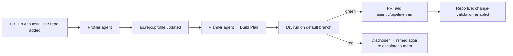

# 08 — Repository Contract

## 1. Onboarding flow



A repo is **live** once a trusted plan exists. Merging the manifest PR is optional but recommended, because without it the generated plan stays authoritative and can be regenerated.

## 2. Detection signals (Profiler)

| Signal | Indicates |
|--------|-----------|
| `pom.xml`, `build.gradle(.kts)`, `settings.gradle`, `gradlew` | JVM (Maven / Gradle), multi-module layout |
| `package.json` + `pnpm-lock.yaml` / `yarn.lock` / `package-lock.json` / `bun.lockb`, `pnpm-workspace.yaml`, `nx.json`, `turbo.json` | JS/TS, package manager, monorepo tool |
| `pyproject.toml` (+ `uv.lock` / `poetry.lock`), `requirements*.txt`, `setup.py` | Python, tool |
| `go.mod`, `go.work` | Go, workspace |
| `Cargo.toml` + `[workspace]` | Rust, workspace |
| `*.sln`, `*.csproj`, `global.json`, `Directory.Packages.props` | .NET |
| `CMakeLists.txt`, `meson.build`, `Makefile`, `conanfile.*`, `vcpkg.json` | C/C++ |
| `WORKSPACE`, `MODULE.bazel`, `BUILD(.bazel)`, `pants.toml` | Bazel / Pants |
| `Dockerfile*`, `docker-compose*.yml`, `Containerfile` | Container image outputs, test services |
| `*.tf`, `Chart.yaml`, `kustomization.yaml`, `Pulumi.yaml` | IaC (scan / plan pipelines) |
| `Podfile`, `*.xcodeproj`, `build.gradle` with `com.android.*` | Mobile (needs macOS / Android pools) |
| `.github/workflows/*.yml`, `Jenkinsfile`, `.circleci/` | Existing CI: commands to reuse and migration hints |
| `CODEOWNERS`, `catalog-info.yaml` | Ownership |
| `.nvmrc`, `.python-version`, `rust-toolchain.toml`, `.tool-versions`, `.sdkmanrc` | Toolchain versions |

## 3. Manifest: `.agentic/pipeline.yaml`

Everything is optional. Anything left out is inferred.

```yaml
apiVersion: agentic-pipeline/v1
team: payments                      # overrides CODEOWNERS inference
autonomy: L2                        # L0..L4, capped by org policy

triggers:                           # narrow or extend the default scope matrix, catalog events only
  draftBuilds: false
  branchBuilds: ["spike/*"]
  ignorePaths: ["docs/**", "*.md"]
  labelTriggers:
    deploy-preview: { pipelineKind: deploy, environment: preview }
  schedules:
    - id: nightly-e2e
      cron: "0 2 * * *"
      pipelineKind: nightly

projects:                           # monorepo: explicit projects (otherwise inferred)
  - id: api
    path: services/api
  - id: web
    path: apps/web

build:
  plan: generated                   # generated | manual (use the `jobs:` below verbatim)
  toolchains: { jdk: "21", node: "22" }
  pools: { default: linux-amd64-medium }

test:
  selection: impact                 # all | impact | affected-projects
  quarantine: auto                  # auto | propose | off

gates:
  coverage: { diff: 80 }
  vulnerabilities: { maxSeverity: high, allowUnfixable: true }
  sast: required

release:
  strategy: semver-conventional
  tagPattern: "v*"
  publish: [ghcr, npm]

deploy:
  environments:
    - name: dev
      auto: true
    - name: prod
      approval: { teams: [payments-leads], count: 1 }
      healthGate: { slo: checkout-availability, bakeMinutes: 30 }

notifications:
  slack: "#payments-ci"

agentDevelopment:                   # work plane (doc 14)
  enabled: true
  jiraProjects: [PAY]               # tasks from these projects may target this repo
  components: [refunds, payouts]    # Jira component → this repo (repo resolution)
  innerLoop:                        # optional; defaults come from the Build Plan
    build: ./gradlew :services:api:compileJava
    test: ./gradlew :services:api:test --tests "$AP_TEST_FILTER"
  forbiddenPaths: ["db/migration/V1__*.sql", "infra/**"]   # in addition to org defaults
  maxSessionCost: { amount: "15.00", currency: USD }
  reviewers: { always: [payments-leads] }

integration:                        # doc 15 §7
  system: payments
  strategy: baseline-overlay
  suites:
    - name: api
      command: ./gradlew integrationTest -Penv.url=$AP_ENV_URL
  data: { strategy: db-branch, seed: src/test/resources/integration-seed.sql }
  requiredFor: [agent-authored]
```

Manifest changes produce `ap.repo.manifest.changed`, which invalidates the plan. The manifest is validated against a published JSON Schema, and errors are annotated on the PR that changes it.

## 4. Org and team layering

`org baseline policy` → `team defaults` → `repo manifest`, merged in that order. **Policy can only be tightened downstream**: a repo cannot lower org gates or raise autonomy above its team cap.

## 5. Monorepos

- Projects are inferred from workspace tooling (Nx / Turborepo / Bazel / Gradle / Cargo / Go workspaces) or declared explicitly.
- `ap.build.source.change_set.computed` maps changed paths to affected projects, and only those projects' jobs are planned (`test.selection: affected-projects`).
- For native graph tools (Bazel, Nx, Pants), the plan delegates target selection to the tool (`bazel query rdeps`, `nx affected`) and records the result in `ap.test.selection.computed`.
- Each project has its own concurrency sub-group and gate results. The single required check aggregates them.
