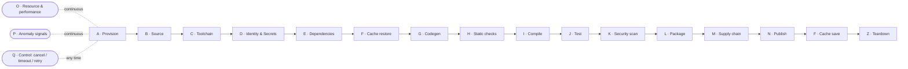

# 12 — Build Process Events

> This document breaks the inside of a build into events. [04 Event Catalog](04-event-catalog.md) treats a job as a black box (`ap.pipeline.job.started` → `ap.pipeline.job.completed`). This document defines **everything that happens inside a job**, from sandbox provisioning to teardown, as a language-agnostic event model. Handlers can then react to *specific* build facts, such as "lockfile drift", "OOM in compile" or "image built for arm64", instead of scraping logs.
>
> Machine-readable source of truth: [`catalog/build-events.yaml`](catalog/build-events.yaml). Handlers are defined in [13 — Event Handlers](13-event-handlers.md).

## 1. Why model the build process as events

| Without build-process events | With build-process events |
|------------------------------|---------------------------|
| Failure diagnosis means an LLM reads 40 MB of log | The Diagnoser receives `ap.build.dependency.fetch.failed` with `registry`, `package`, `httpStatus`, so most failures are classified **deterministically** without an LLM call |
| "Why is this build slow?" needs someone to dig | Phase durations, cache hit ratios and resource peaks are first-class events, so regressions are detected automatically |
| Supply-chain evidence is reconstructed after the fact | Every input (source SHA, toolchain digest, lockfile digest, base image) is attested as it is resolved |
| Each language has its own story | One canonical lifecycle. Maven, npm, Cargo, Go, Bazel and others all map onto the same phases. |

## 2. The canonical build lifecycle

Every job, in any language, moves through the phases below. Phases may be **skipped** (a lint-only job skips packaging), but they never reorder. Each phase emits its own events.

### 2.1 How phases map to ecosystems

| Phase | Maven/Gradle | npm/pnpm/yarn | Python (uv/poetry/pip) | Go | Rust | .NET | Bazel/Pants | Container |
|-------|--------------|---------------|------------------------|----|------|------|-------------|-----------|
| C Toolchain | JDK, Gradle wrapper | Node via `.nvmrc`/`engines` | Python via `.python-version` | `go.mod` toolchain | `rust-toolchain.toml` | `global.json` | hermetic toolchains | BuildKit |
| E Dependencies | `dependency:resolve`, Gradle resolve | `npm ci` / `pnpm install --frozen-lockfile` | `uv sync --frozen` | `go mod download` | `cargo fetch --locked` | `dotnet restore --locked-mode` | repository rules / `bazel fetch` | base image pull |
| G Codegen | protobuf/openapi plugins | `graphql-codegen` | `grpcio-tools` | `go generate` | `build.rs` | source generators | genrules | — |
| H Static | Checkstyle, SpotBugs, ktlint | ESLint, Prettier, `tsc --noEmit` | ruff, mypy/pyright | `go vet`, golangci-lint | clippy, rustfmt | analyzers, `dotnet format` | lint aspects | hadolint |
| I Compile | `compile`/`assemble` | `tsc`, bundlers | (bytecode / C ext) | `go build` | `cargo build` | `dotnet build` | `bazel build` | `docker buildx build` |
| J Test | Surefire/Failsafe, JUnit | Jest, Vitest, Playwright | pytest | `go test` | `cargo test`/nextest | `dotnet test` | `bazel test` | container-structure-test |
| L Package | jar/war | `npm pack` | wheel/sdist | binary | crate/binary | nupkg | `pkg_*` rules | OCI image |

## 3. Emission tiers

Build processes are chatty. A monorepo job can contain 10,000 test cases and 1,000 compile actions. Not everything belongs on the bus.

| Tier | Where it goes | Use | Examples |
|------|---------------|-----|----------|
| **B — Bus** | Event bus (durable, partitioned by repo) | Facts a handler **routes or decides** on | `ap.build.dependency.lockfile.drift.detected`, `ap.build.compile.completed` |
| **S — Summary** | Bus, **once per phase/job**, with aggregates plus a reference to detail | High-cardinality data compressed into one fact | `ap.test.results.reported` (counts plus a JUnit reference) |
| **T — Telemetry** | OpenTelemetry spans, metrics and logs only | Timelines, debugging, per-action detail | individual compile actions, per-test-case spans, heartbeats |

Rule: **a handler can only subscribe to tier B or S.** If a handler needs tier T data, it either becomes a summary event or the handler reads the referenced artifact.

## 4. Common step envelope

Every phase emits a generic pair in **tier T**, for timeline rendering:

- `ap.build.step.started.v1` / `ap.build.step.completed.v1`, with `data: { runId, jobKey, attempt, phase, stepKey, tool, command (redacted), conclusion, durationMs, exitCode }`

Phases with **semantic outcomes** also emit the **typed tier B/S events** listed below. Handlers subscribe to the typed events and never parse `step.*`.

Common `data` fields on every build-process event (omitted from the tables): `runId`, `jobKey`, `attempt`, `phase`, `executorId`, `pool`, `arch`.

---

## 5. Event inventory by category

IDs (`BP-xx-nn`) are stable references for categorisation, handler mapping and test fixtures.

### A — Job lifecycle & sandbox

| ID | Type | Class | Tier | Key data | Why it matters |
|----|------|-------|------|----------|----------------|
| BP-A-01 | `ap.build.sandbox.requested.v1` | I | B | `pool`, `isolation` (`microvm`/`gvisor`), `resources{cpu,memGiB,diskGiB}`, `trustLevel` | Scheduler and autoscaler input |
| BP-A-02 | `ap.build.sandbox.provisioned.v1` | F | B | `sandboxId`, `image`, `imageDigest`, `kernel`, `provisionMs`, `warmPool` (bool) | Cold-start metrics; supply-chain input (builder image) |
| BP-A-03 | `ap.build.sandbox.provision.failed.v1` | F | B | `reason` (`capacity`, `image-pull`, `quota`, `node-failure`) | Infra failure: retry on another node, never blamed on code |
| BP-A-04 | `ap.pipeline.job.started.v1` | F | B | *(existing, see 04)* | |
| BP-A-05 | `ap.build.job.heartbeat.v1` | S | T | `lastOutputAt`, `phase` | Lost-job and hang detection (metric only) |
| BP-A-06 | `ap.pipeline.job.lost.v1` | F | B | *(existing)* | Reschedule |
| BP-A-07 | `ap.build.sandbox.destroyed.v1` | F | B | `sandboxId`, `wiped` (bool), `lifetimeMs` | Proof of ephemerality (SLSA isolation) |
| BP-A-08 | `ap.pipeline.job.completed.v1` | F | B | *(existing)* plus `phaseSummary[]` | The terminal job fact |

### B — Source & workspace

| ID | Type | Class | Tier | Key data | Why it matters |
|----|------|-------|------|----------|----------------|
| BP-B-01 | `ap.build.source.checked_out.v1` | F | B | `repo`, `sha`, `ref`, `depth`, `sparsePaths[]`, `submodules[]{path,sha}`, `lfsObjects`, `durationMs` | Provenance input; proves exactly which source was built |
| BP-B-02 | `ap.build.source.checkout.failed.v1` | F | B | `reason` (`sha-not-found`, `auth`, `lfs-quota`, `submodule-unreachable`, `timeout`) | Force-push races (sha gone ⇒ supersede, not fail) |
| BP-B-03 | `ap.build.source.merge_ref.computed.v1` | F | B | `headSha`, `baseSha`, `mergeSha`, `conflicts` (bool) | PR builds test the merge result; conflicts end the run early |
| BP-B-04 | `ap.build.workspace.integrity.verified.v1` | F | S | `treeHash`, `signedCommit` (bool), `signer?` | Commit signature policy |
| BP-B-05 | `ap.build.source.change_set.computed.v1` | F | B | `changedPaths` (count plus ref), `affectedProjects[]`, `affectedTargets` (count) | Drives test selection and monorepo fan-out |

### C — Toolchain & environment

| ID | Type | Class | Tier | Key data | Why it matters |
|----|------|-------|------|----------|----------------|
| BP-C-01 | `ap.build.toolchain.resolved.v1` | F | B | `toolchains[]{name,requested,resolved,digest,source}` (e.g. `jdk 21 → temurin-21.0.5+11`) | Fingerprint input; reproducibility |
| BP-C-02 | `ap.build.toolchain.install.failed.v1` | F | B | `toolchain`, `requested`, `reason` (`unavailable`, `checksum`, `arch-unsupported`) | Toolchain class failure, often fixable by the Remediator |
| BP-C-03 | `ap.build.toolchain.mismatch.detected.v1` | S | B | `declared` (manifest/.nvmrc), `observed`, `source` | Drift between repo declaration and executor image |
| BP-C-04 | `ap.build.toolchain.deprecated.detected.v1` | S | B | `toolchain`, `version`, `eolDate` | Feeds upgrade proposals (Dependency agent) |
| BP-C-05 | `ap.build.environment.prepared.v1` | F | S | `envVars` (names only), `services[]` (testcontainers / sidecars), `network` (egress profile) | Audit what the job could reach |

### D — Identity & secrets

| ID | Type | Class | Tier | Key data | Why it matters |
|----|------|-------|------|----------|----------------|
| BP-D-01 | `ap.build.identity.issued.v1` | F | B | `subject` (OIDC `sub`), `audiences[]`, `ttlS`, `claims` (repo, ref, runId, trustLevel) | Every cloud credential traces back to a job |
| BP-D-02 | `ap.build.secret.granted.v1` | F | B | `secretNames[]`, `policyDecisionId`, `scope` | **Names only, never values.** Audit. |
| BP-D-03 | `ap.build.secret.denied.v1` | F | B | `secretName`, `reason` (`untrusted-fork`, `ref-not-allowed`, `policy`) | Explains "why did my fork PR fail on deploy step?" |
| BP-D-04 | `ap.build.secret.exposure.detected.v1` | S | B | `secretName?`, `location` (`log`/`artifact`/`cache`), `redacted` (bool) | **P0.** Triggers rotation and artifact quarantine. |
| BP-D-05 | `ap.build.credential.use.failed.v1` | F | B | `target` (registry, cloud), `reason` (`expired`, `forbidden`, `audience`) | Infra/config failure classification |

### E — Dependencies

| ID | Type | Class | Tier | Key data | Why it matters |
|----|------|-------|------|----------|----------------|
| BP-E-01 | `ap.build.dependency.resolution.completed.v1` | F | S | `ecosystem`, `lockfile{path,digest}`, `direct`, `transitive`, `sources[]` (proxy/registry), `fromCache` (count), `durationMs` | Fingerprint input; SBOM seed |
| BP-E-02 | `ap.build.dependency.fetch.failed.v1` | F | B | `ecosystem`, `package`, `version`, `registry`, `httpStatus`, `reason` (`not-found`, `auth`, `timeout`, `rate-limited`, `yanked`) | Deterministic classification (`infra` vs `dependency`) |
| BP-E-03 | `ap.build.dependency.lockfile.drift.detected.v1` | F | B | `lockfile`, `manifest`, `kind` (`missing`, `out-of-date`, `frozen-violation`) | Classic auto-remediation: regenerate lockfile in a PR |
| BP-E-04 | `ap.build.dependency.integrity.failed.v1` | F | B | `package`, `expectedDigest`, `actualDigest`, `registry` | **Security.** Possible tampering. Block and alert. |
| BP-E-05 | `ap.build.dependency.conflict.detected.v1` | F | B | `package`, `constraints[]`, `resolver` message ref | Version-resolution failures (peer deps, Maven convergence) |
| BP-E-06 | `ap.build.dependency.policy.violation.v1` | F | B | `package`, `rule` (`license-denied`, `banned-package`, `unpinned`, `untrusted-registry`, `typosquat-suspect`), `severity` | Gate input |
| BP-E-07 | `ap.build.dependency.internal.consumed.v1` | F | S | `packages[]{name,version,producerRepo}` | Builds the **reverse-dependency graph** so internal releases fan out |
| BP-E-08 | `ap.build.dependency.vulnerable.detected.v1` | F | S | `findings{critical,high,…}`, `advisories[]` (top N), `reportRef` | Gate input; remediation trigger |

### F — Caching

| ID | Type | Class | Tier | Key data | Why it matters |
|----|------|-------|------|----------|----------------|
| BP-F-01 | `ap.build.cache.restored.v1` | F | S | `cacheKind` (`deps`, `build`, `remote-exec`, `docker-layer`, `test-results`), `key`, `result` (`hit`/`partial`/`miss`), `bytes`, `durationMs` | Cache effectiveness; cost |
| BP-F-02 | `ap.build.cache.saved.v1` | F | S | `cacheKind`, `key`, `bytes`, `scope` (`ref`/`default-branch`/`tenant`) | |
| BP-F-03 | `ap.build.cache.remote_exec.summary.v1` | S | S | `actions`, `cached`, `remote`, `local`, `hitRatio` | Bazel/REAPI efficiency |
| BP-F-04 | `ap.build.cache.poisoning.suspected.v1` | S | B | `key`, `writerRunId`, `writerTrustLevel`, `reason` (`untrusted-writer`, `digest-mismatch`) | **Security.** Untrusted PRs must never write to trusted cache scopes. |
| BP-F-05 | `ap.build.cache.evicted.v1` | F | T | `key`, `reason` | Telemetry only |

### G — Code generation

| ID | Type | Class | Tier | Key data | Why it matters |
|----|------|-------|------|----------|----------------|
| BP-G-01 | `ap.build.codegen.completed.v1` | F | S | `generators[]{tool,version,inputs,outputs}`, `conclusion` | |
| BP-G-02 | `ap.build.codegen.drift.detected.v1` | F | B | `paths[]`, `generator` | Committed generated code ≠ regenerated output. Auto-fixable. |

### H — Static checks (lint, format, typecheck)

| ID | Type | Class | Tier | Key data | Why it matters |
|----|------|-------|------|----------|----------------|
| BP-H-01 | `ap.build.lint.completed.v1` | F | S | `tool`, `errors`, `warnings`, `fixable`, `sarifRef`, `newInThisChange` (count) | Annotations; auto-fix proposals |
| BP-H-02 | `ap.build.format.check.completed.v1` | F | S | `tool`, `filesUnformatted`, `patchRef` (formatter diff) | **Trivial auto-remediation**: commit the formatter output |
| BP-H-03 | `ap.build.typecheck.completed.v1` | F | S | `tool`, `errors`, `diagnosticsRef` | Classified `code` |
| BP-H-04 | `ap.build.static.baseline.regressed.v1` | S | B | `tool`, `baseline`, `current`, `delta` | Ratchet gate: no *new* warnings |

### I — Compilation

| ID | Type | Class | Tier | Key data | Why it matters |
|----|------|-------|------|----------|----------------|
| BP-I-01 | `ap.build.compile.started.v1` | F | T | `tool`, `targets` (count) | Telemetry |
| BP-I-02 | `ap.build.compile.completed.v1` | F | S | `tool`, `conclusion`, `targets{built,cached,failed}`, `errors`, `warnings`, `diagnosticsRef`, `durationMs` | Core build outcome |
| BP-I-03 | `ap.build.compile.error.classified.v1` | F | B | `kind` (`syntax`, `type`, `missing-symbol`, `linker`, `incompatible-api`, `generated-code`), `locations[]` (top N), `suspectPaths[]` | Deterministic pre-classification before the Diagnoser (cheap path) |
| BP-I-04 | `ap.build.compile.warnings.regressed.v1` | S | B | `baseline`, `current`, `newWarnings[]` (top N) | Ratchet gate |
| BP-I-05 | `ap.build.compile.target.platform.completed.v1` | F | S | `platform` (`linux/amd64`, `linux/arm64`, `darwin/arm64`, `windows/amd64`), `conclusion` | Multi-arch matrix results |

### J — Testing

| ID | Type | Class | Tier | Key data | Why it matters |
|----|------|-------|------|----------|----------------|
| BP-J-01 | `ap.test.selection.computed.v1` | F | S | *(existing)* `strategy`, `selected`, `total`, `skippedByImpact` | Explains why tests were skipped |
| BP-J-02 | `ap.build.test.services.started.v1` | F | S | `services[]{name,image,digest,readyMs}` (DBs, brokers, testcontainers) | Separates infra failures from test failures |
| BP-J-03 | `ap.build.test.services.failed.v1` | F | B | `service`, `reason` (`pull`, `healthcheck`, `port`) | Classified `infra`; retry |
| BP-J-04 | `ap.build.test.suite.completed.v1` | F | S | `level` (`unit`, `integration`, `e2e`, `contract`, `perf`, `mutation`), `passed`, `failed`, `skipped`, `durationMs`, `reportRef` | Per-level gates |
| BP-J-05 | `ap.test.results.reported.v1` | F | S | *(existing)* job-level aggregate | |
| BP-J-06 | `ap.build.test.case.failed.v1` | F | B (capped at 50/job, then summary) | `testId` (stable hash of suite plus name), `name`, `failureKind` (`assertion`, `error`, `timeout`, `crash`), `messageRef`, `historicalPassRate` | Flake detection, ownership routing, quarantine |
| BP-J-07 | `ap.test.flake.detected.v1` | S | B | *(existing)* | |
| BP-J-08 | `ap.build.test.coverage.reported.v1` | F | S | `line`, `branch`, `diffCoverage` (changed lines), `reportRef`, `baseline` | Coverage gate (diff-coverage preferred) |
| BP-J-09 | `ap.build.test.contract.verified.v1` | F | S | `provider`, `consumer`, `contractVersion`, `result` (Pact / schema compat) | Cross-repo compatibility, consumed by the Release handler |
| BP-J-10 | `ap.build.test.performance.regressed.v1` | S | B | `benchmark`, `baseline`, `current`, `deltaPct`, `significance` | Perf gate |
| BP-J-11 | `ap.build.test.timeout.v1` | F | B | `testId?`, `suite`, `limitS`, `hangDumpRef?` | Distinguishes hangs from failures |

### K — Security & compliance scanning

| ID | Type | Class | Tier | Key data | Why it matters |
|----|------|-------|------|----------|----------------|
| BP-K-01 | `ap.build.scan.sast.completed.v1` | F | S | `tool` (CodeQL, Semgrep), `findings{…}`, `newFindings`, `sarifRef` | Gate; upload to GitHub code scanning |
| BP-K-02 | `ap.build.scan.sca.completed.v1` | F | S | `tool` (OSV-Scanner, Grype, Trivy), `findings{…}`, `reachable?`, `reportRef` | Gate |
| BP-K-03 | `ap.build.scan.secrets.completed.v1` | F | S | `tool` (gitleaks / trufflehog), `findings`, `verified` | A finding also emits BP-D-04 |
| BP-K-04 | `ap.build.scan.iac.completed.v1` | F | S | `tool` (Checkov, tfsec, kube-linter), `findings{…}` | IaC repos |
| BP-K-05 | `ap.build.scan.license.completed.v1` | F | S | `denied[]`, `unknown[]`, `reportRef` | Compliance gate |
| BP-K-06 | `ap.build.scan.container.completed.v1` | F | S | `imageDigest`, `findings{…}`, `baseImage`, `baseImageAgeDays` | Base-image freshness drives rebuild proposals |
| BP-K-07 | `ap.build.scan.malware.suspected.v1` | S | B | `package/file`, `indicator` (install scripts, obfuscation, exfil pattern) | **P0** supply-chain signal |

### L — Packaging & containerisation

| ID | Type | Class | Tier | Key data | Why it matters |
|----|------|-------|------|----------|----------------|
| BP-L-01 | `ap.build.package.created.v1` | F | S | `kind` (jar, wheel, npm tgz, crate, nupkg, binary, helm chart, zip), `name`, `version`, `digest`, `size` | Becomes `ap.artifact.built` |
| BP-L-02 | `ap.build.image.built.v1` | F | S | `platform`, `digest`, `baseImage{ref,digest}`, `layers`, `sizeBytes`, `builder` (buildkit/kaniko/jib/ko/bazel), `cacheHitLayers` | Per-arch image |
| BP-L-03 | `ap.build.image.index.assembled.v1` | F | B | `indexDigest`, `manifests[]{platform,digest}` | Multi-arch image ready. Triggers sign and scan. |
| BP-L-04 | `ap.build.version.computed.v1` | F | B | `version`, `scheme` (`semver`/`calver`/`sha`), `source` (conventional commits, tag, manifest), `isPrerelease` | Single source of version truth for all package kinds |
| BP-L-05 | `ap.build.reproducibility.checked.v1` | F | S | `artifact`, `rebuildDigest`, `originalDigest`, `match` (bool) | Non-determinism detection (sampled) |
| BP-L-06 | `ap.artifact.built.v1` | F | B | *(existing)*, emitted once the packaging phase is done | |

### M — Supply chain (SBOM, provenance, signing)

| ID | Type | Class | Tier | Key data | Why it matters |
|----|------|-------|------|----------|----------------|
| BP-M-01 | `ap.artifact.sbom.generated.v1` | F | B | *(existing)* | |
| BP-M-02 | `ap.artifact.provenance.generated.v1` | F | B | *(existing)*. Generated by the **trusted control plane**, not the job. | SLSA L3 requires a non-forgeable builder |
| BP-M-03 | `ap.artifact.signed.v1` | F | B | *(existing)* | |
| BP-M-04 | `ap.build.attestation.failed.v1` | F | B | `artifactId`, `stage` (`sbom`, `provenance`, `sign`, `transparency-log`), `reason` | Blocks publish; infra vs policy classification |
| BP-M-05 | `ap.build.vex.generated.v1` | F | S | `artifactId`, `statements` (count), `vexRef` | Not-affected justifications for scanners |

### N — Publishing

| ID | Type | Class | Tier | Key data | Why it matters |
|----|------|-------|------|----------|----------------|
| BP-N-01 | `ap.build.publish.requested.v1` | I | B | `artifactId`, `targets[]` (registry, channel), `policyDecisionId` | Publish is an intent that policy can deny (unsigned, failed gate) |
| BP-N-02 | `ap.artifact.published.v1` | F | B | *(existing)* | |
| BP-N-03 | `ap.build.publish.failed.v1` | F | B | `target`, `reason` (`auth`, `conflict-version-exists`, `quota`, `immutability`, `timeout`) | `conflict` ⇒ version bump proposal, not a retry |
| BP-N-04 | `ap.build.docs.published.v1` | F | S | `site`, `url`, `version` | API docs, Storybook, etc. |

### O — Resource & performance

| ID | Type | Class | Tier | Key data | Why it matters |
|----|------|-------|------|----------|----------------|
| BP-O-01 | `ap.build.resources.reported.v1` | F | S | per phase: `cpuSeconds`, `peakMemMiB`, `peakDiskGiB`, `netEgressMiB`, `wallMs`, `cost` | Right-sizing; cost attribution per team |
| BP-O-02 | `ap.build.resource.exhausted.v1` | F | B | `resource` (`memory`/`disk`/`pids`/`cpu-throttle`), `phase`, `limit`, `peak` | Classified `resource`. The Remediator proposes a larger pool or tuned flags. |
| BP-O-03 | `ap.build.duration.regressed.v1` | S | B | `scope` (job/phase), `p50Baseline`, `current`, `deltaPct`, `suspectCommits[]` | Build-performance ownership |
| BP-O-04 | `ap.build.queue.wait.reported.v1` | F | S | `waitMs`, `pool`, `priority` | Fairness SLOs |

### P — Anomaly & health signals

| ID | Type | Class | Tier | Key data | Why it matters |
|----|------|-------|------|----------|----------------|
| BP-P-01 | `ap.build.step.hung.detected.v1` | S | B | `phase`, `stepKey`, `silentForS`, `stackDumpRef?` | Kill early instead of waiting for the global timeout |
| BP-P-02 | `ap.build.network.egress.denied.v1` | S | B | `destination` (host:port), `phase`, `process` | Either a missing allowlist entry (config) or exfiltration (security) |
| BP-P-03 | `ap.build.nondeterminism.detected.v1` | S | B | `artifact`, `diffRef` | Reproducibility |
| BP-P-04 | `ap.build.health.degraded.v1` | S | B | `repo`, `scope` (default branch), `metric` (`success-rate`/`flake-rate`/`cache-hit`/`duration`), `window`, `value` | Repo-health signal for owning teams |
| BP-P-05 | `ap.build.mainline.broken.v1` | F | B | `ref`, `firstFailingSha`, `lastGreenSha`, `suspectCommits[]` | **P1.** Bisect plus revert proposal plus team page. |
| BP-P-06 | `ap.build.mainline.recovered.v1` | F | B | `ref`, `fixedBySha`, `brokenForMs` | Mainline MTTR |

### Q — Control (cancel, timeout, retry)

| ID | Type | Class | Tier | Key data | Why it matters |
|----|------|-------|------|----------|----------------|
| BP-Q-01 | `ap.build.job.cancel.requested.v1` | I | B | `reason` (`superseded`, `user`, `run-failed-fast`, `ref-deleted`, `tenant-uninstalled`) | |
| BP-Q-02 | `ap.build.job.cancelled.v1` | F | B | `phaseAtCancel`, `graceful` (bool) | |
| BP-Q-03 | `ap.build.job.timed_out.v1` | F | B | `phaseAtTimeout`, `limitS` | Different handling from `failure` |
| BP-Q-04 | `ap.pipeline.job.retry.requested.v1` | I | B | *(existing)* | |
| BP-Q-05 | `ap.build.step.retried.v1` | F | S | `stepKey`, `attempt`, `reason` (in-job retries such as network fetch) | Hidden flakiness indicator |

---

## 6. Phase failure → diagnosis class (deterministic pre-classification)

Before any LLM is involved, the **Failure Classifier** handler (see [13](13-event-handlers.md#h-diag-01-failure-classifier)) maps typed failure events to a diagnosis class. Only `unknown`, or low-confidence cases, go to the Diagnoser agent.

| Failure event | Default class | Default action |
|---------------|---------------|----------------|
| `sandbox.provision.failed`, `job.lost`, `test.services.failed` | `infra` | auto-retry (≤ 2) on a different node |
| `source.checkout.failed{sha-not-found}` | `superseded` | cancel quietly |
| `source.merge_ref.computed{conflicts}` | `config` | comment, ask the author to rebase |
| `toolchain.install.failed`, `toolchain.mismatch.detected` | `toolchain` | Remediator: pin or align toolchain |
| `dependency.fetch.failed{timeout,rate-limited,5xx}` | `infra` | retry with backoff |
| `dependency.fetch.failed{not-found,yanked}` | `dependency` | Remediator: version proposal |
| `dependency.lockfile.drift.detected` | `dependency` | Remediator: regenerate lockfile |
| `dependency.integrity.failed`, `scan.malware.suspected`, `cache.poisoning.suspected`, `secret.exposure.detected` | `security` | block, quarantine, page security |
| `codegen.drift.detected`, `format.check.completed{filesUnformatted>0}` | `config` | Remediator: commit regenerated/formatted output |
| `compile.error.classified` | `code` | annotate, Diagnoser summary, optional fix proposal |
| `test.case.failed` with `historicalPassRate > 0.9` and same-SHA pass | `test-flaky` | retry failed tests, flake record, quarantine proposal |
| `test.case.failed` (other) | `test-assertion` | annotate, owner routing |
| `resource.exhausted` | `resource` | retry on a larger pool once, then right-size proposal |
| `job.timed_out`, `step.hung.detected` | `timeout` | dump, Diagnoser |
| `network.egress.denied` | `config` or `security` | policy decides from the destination reputation list |
| `publish.failed{conflict-version-exists}` | `config` | version bump proposal |
| `credential.use.failed`, `secret.denied` | `config` / `policy` | explain to the author (fork PR, ref restriction) |
| anything else | `unknown` | **Diagnoser agent** |

## 7. Volume estimates (per 50k jobs/day)

| Tier | Events per job (typ.) | Daily volume | Notes |
|------|-----------------------|--------------|-------|
| B | 8–20 | 0.4–1 M | Comfortable for a partitioned log |
| S | 10–25 | 0.5–1.25 M | |
| T | 100–100,000 | 50 M+ spans | OTel backend, sampled at the tail for successful runs |

## 8. Producer contract for executors

The executor ships an **`ap-sidecar`** (a build-process event emitter, not an LLM agent) that:

1. Wraps each planned step, emits `step.*` telemetry, and records exit code and timing.
2. Runs **phase parsers** per tool, such as Maven/Gradle output, npm error codes, `go build` diagnostics, JUnit/xUnit/TRX/TAP reports, SARIF and BuildKit progress. It converts them into typed events. Parsers are versioned plugins.
3. Uploads bulk outputs (logs, reports, SARIF) to the artifact store **before** emitting the event that references them.
4. Signs the event batch with the job's workload identity. The control plane rejects build events whose `runId/jobKey` don't match the identity's claims. **A job cannot forge events for another job.**
5. Never emits supply-chain *attestations* itself. Provenance is generated by the control plane from observed facts (SLSA L3 non-forgeability).
