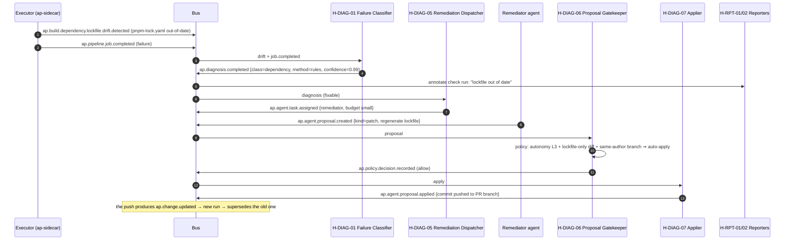
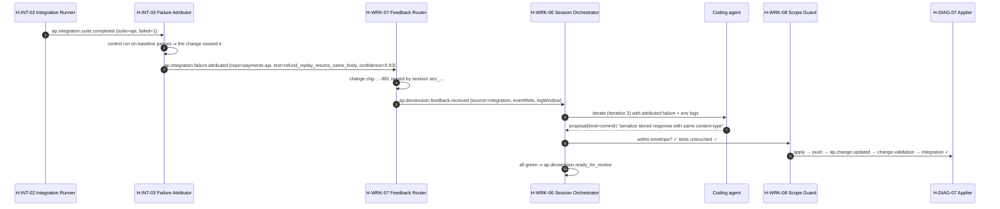

# 13 — Event Handlers

> A **handler** is a named consumer that subscribes to one or more canonical event types, makes a decision or performs a side effect, and (usually) emits further events. The handler registry and the event catalog together define the **complete behaviour** of the pipeline. An event with no handler is noise. A handler subscribing to an uncatalogued event is a bug.
>
> Machine-readable: [`catalog/handlers.yaml`](catalog/handlers.yaml).

## 1. Handler rules

1. **Single responsibility.** A handler owns one decision or one side effect. "Classify failure" and "open a fix PR" are two handlers.
2. **Decide, then act.** Where possible, split a handler into a *pure decision* (input events → output intents, unit-testable and replayable) and an *effectful applier* (intent → external call).
3. **Idempotent on a declared key.** Every handler declares its idempotency key. Duplicate deliveries must be no-ops.
4. **Partition affinity.** Handlers that need per-repo ordering consume in partition order and keep their state keyed by `repo`/`subject`. Handlers that don't are horizontally parallel.
5. **Bounded latency class.** Each handler has a latency class, and the bus gives each class its own consumer group so a slow projection never delays a hot-path router.
   - **hot** (< 1 s p95): routing, orchestration, cancellation
   - **warm** (< 30 s): reporting, classification, gates
   - **cold** (minutes): agents, analytics, GC
6. **Failure policy is explicit.** Each handler has `retry` (count, backoff), a `dlq`, and `onExhausted` (`alert`, `emit-failure-event`, `drop-with-ledger`).
7. **Agents are behind handlers.** An LLM agent is never a direct bus consumer. A deterministic handler decides *whether* to invoke it (budget, policy, dedupe) and emits `ap.agent.task.assigned`.
8. **Handlers never write to GitHub directly**, except the Reporter and the Applier, which are the only holders of write-scoped installation tokens.

## 2. Handler kinds

| Kind | Description | Example |
|------|-------------|---------|
| `router` | Stateless mapping from facts to intents | Trigger Router |
| `controller` | Stateful, drives an aggregate's state machine (durable workflow) | Run Orchestrator |
| `classifier` | Deterministic rules from facts to a decision fact | Failure Classifier |
| `agent-invoker` | Decides whether and how to invoke an LLM agent | Diagnosis Dispatcher |
| `applier` | Carries out approved intents against external systems | Remediation Applier |
| `responder` | Fast reaction to security or health signals | Secret Exposure Responder |
| `reporter` | Projects state onto external surfaces | GitHub Checks Reporter |
| `projector` | Builds read models and metrics | DORA Projector |
| `janitor` | Lifecycle, cleanup, GC | Cache GC |

## 3. Handler categories and registry

### 3.1 Ingestion (`H-ING`)

| ID | Handler | Kind | Subscribes | Emits | Latency | Idempotency key |
|----|---------|------|------------|-------|---------|-----------------|
| H-ING-01 | Webhook Receiver | (HTTP) | GitHub / generic HTTP | `ap.raw.*.received` | hot | `X-GitHub-Delivery` |
| H-ING-02 | Normalizer | router | `ap.raw.*.received` | L1 events, `ap.raw.ignored` | hot | `deliveryId + mappingVersion` |
| H-ING-03 | Reconciler | controller | timer, `ap.tenant.installed`, `ap.repo.added` | synthetic L1 (`origin=reconciler`), `ap.repo.settings.drift.detected` | cold | `repo + objectId + observedState` |
| H-ING-04 | Comment Command Parser | classifier | `ap.change.comment.created` | `ap.command.received` | hot | `commentId` |
| H-ING-05 | External Feed Adapters | router | registry webhooks, OSV/GHSA, PagerDuty, monitoring | `ap.dependency.upstream.released`, `ap.security.advisory.published`, `ap.environment.*` | warm | upstream ID |

### 3.2 Routing & intent (`H-RTE`)

| ID | Handler | Kind | Subscribes | Emits | Latency | Idempotency key |
|----|---------|------|------------|-------|---------|-----------------|
| H-RTE-01 | Trigger Router | router | all L1 `scm`, `change`, `mergequeue`, `schedule`, `release`, `security`, `dependency` | `ap.pipeline.run.requested`, `ap.release.requested`, `ap.deployment.requested` | hot | `triggerEventId + pipelineKind` |
| H-RTE-02 | Command Authorizer | classifier | `ap.command.received` | `ap.command.accepted` + intent, or `ap.command.rejected` | hot | `commandId` |
| H-RTE-03 | Internal Dependency Fan-out | router | `ap.artifact.published` (internal), `ap.dependency.upstream.released{isInternal}` | `ap.pipeline.run.requested{kind=downstream-compat}` per dependent repo (rate-limited) | warm | `package@version + dependentRepo` |
| H-RTE-04 | Advisory Fan-out | router | `ap.security.advisory.published` | `ap.security.vulnerability.alert.opened` per affected repo (via SBOM index) | warm | `advisory + repo` |
| H-RTE-05 | Pipeline Chainer | router | `ap.pipeline.run.completed`, `ap.release.published`, `ap.deployment.completed` | next-stage intents (e.g. mainline success → release → deploy dev) | warm | `completedEventId + nextKind` |

### 3.3 Orchestration (`H-ORC`)

| ID | Handler | Kind | Subscribes | Emits | Latency | Idempotency key |
|----|---------|------|------------|-------|---------|-----------------|
| H-ORC-01 | Run Orchestrator | controller | `ap.pipeline.run.requested`, `ap.pipeline.job.*`, `ap.gate.evaluated`, `ap.approval.*`, `ap.agent.proposal.*` (own run) | `ap.pipeline.run.*`, `ap.pipeline.stage.*`, `ap.agent.task.assigned`, `ap.approval.requested` | hot | `runId` (workflow ID) |
| H-ORC-02 | Concurrency & Supersession Manager | controller | `ap.pipeline.run.requested`, `ap.change.updated`, `ap.change.closed`, `ap.scm.ref.deleted`, `ap.mergequeue.entry.destroyed` | `ap.pipeline.run.superseded`, `ap.pipeline.run.cancel.requested` | hot | `concurrencyGroup + headSha` |
| H-ORC-03 | Plan Resolver | controller | `ap.pipeline.run.started` (plan stage) | `ap.build.plan.reused` / `ap.agent.task.assigned{planner}` → `ap.build.plan.generated` | warm | `fingerprint` |
| H-ORC-04 | Plan Invalidator | classifier | `ap.repo.manifest.changed`, `ap.build.toolchain.mismatch.detected`, `ap.executor.image.updated`, `ap.build.source.change_set.computed` (build files touched), repeated `ap.diagnosis.completed{class=config}` | `ap.build.plan.invalidated` | warm | `planId + reason` |
| H-ORC-05 | Job Dispatcher / Fair-share Scheduler | controller | `ap.build.sandbox.requested` | `ap.pipeline.job.scheduled`, `ap.build.queue.wait.reported` | hot | `runId/jobKey/attempt` |
| H-ORC-06 | Retry Controller | classifier | `ap.diagnosis.completed`, `ap.pipeline.job.lost`, `ap.build.sandbox.provision.failed` | `ap.pipeline.job.retry.requested` (within budget) | warm | `runId/jobKey/attempt` |
| H-ORC-07 | Watchdog | controller | `ap.build.job.heartbeat` (metric), `ap.build.step.hung.detected` | `ap.build.job.cancel.requested{hung}`, `ap.pipeline.job.lost` | hot | `runId/jobKey/attempt` |
| H-ORC-08 | Cancellation Propagator | controller | `ap.pipeline.run.cancel.requested`, `ap.tenant.uninstalled`, `ap.repo.removed` | `ap.build.job.cancel.requested` (fan-out), `ap.build.job.cancelled` | hot | `runId` |

### 3.4 Execution services (`H-EXE`)

| ID | Handler | Kind | Subscribes | Emits | Latency | Idempotency key |
|----|---------|------|------------|-------|---------|-----------------|
| H-EXE-01 | Sandbox Provisioner | applier | `ap.pipeline.job.scheduled` | `ap.build.sandbox.provisioned` / `…provision.failed` | hot | `runId/jobKey/attempt` |
| H-EXE-02 | Identity Issuer | applier | sandbox boot (sync call) | `ap.build.identity.issued` | hot | `sandboxId` |
| H-EXE-03 | Secret Broker | applier | sandbox secret request (sync) | `ap.build.secret.granted` / `…denied` + `ap.policy.decision.recorded` | hot | `sandboxId + secretName` |
| H-EXE-04 | Cache Broker | applier | sync cache API | `ap.build.cache.restored` / `…saved` / `…poisoning.suspected` | hot | `key + writerRunId` |
| H-EXE-05 | Publisher | applier | `ap.build.publish.requested` (after policy allow) | `ap.artifact.published` / `ap.build.publish.failed` | warm | `artifact digest + target` |
| H-EXE-06 | Sandbox Reaper | janitor | `ap.pipeline.job.completed`, `ap.build.job.cancelled`, `ap.build.job.timed_out` | `ap.build.sandbox.destroyed` | warm | `sandboxId` |

### 3.5 Diagnosis & remediation (`H-DIAG`)

| ID | Handler | Kind | Subscribes | Emits | Latency | Idempotency key |
|----|---------|------|------------|-------|---------|-----------------|
| <a id="h-diag-01-failure-classifier"></a>H-DIAG-01 | Failure Classifier | classifier | all typed failure events in [12 §6](12-build-process-events.md#6-phase-failure--diagnosis-class-deterministic-pre-classification), `ap.pipeline.job.completed{failure}` | `ap.diagnosis.completed{method=rules}` or hands off to H-DIAG-02 | warm | `runId/jobKey/attempt` |
| H-DIAG-02 | Diagnosis Dispatcher | agent-invoker | unclassified or low-confidence failures from H-DIAG-01 | `ap.agent.task.assigned{diagnoser}` → `ap.diagnosis.completed{method=agent}` | cold | `runId/jobKey/attempt` + log digest |
| H-DIAG-03 | Flake Detector | classifier | `ap.build.test.case.failed`, `ap.test.results.reported` | `ap.test.flake.detected` | warm | `testId + sha` |
| H-DIAG-04 | Quarantine Manager | controller | `ap.test.flake.detected`, `ap.command.accepted{quarantine-test}` | `ap.test.quarantined` / `…unquarantined` (expiry timer) | cold | `testId` |
| H-DIAG-05 | Remediation Dispatcher (human-authored changes and mainline only; session-owned changes → H-WRK-07) | agent-invoker | `ap.diagnosis.completed{class∈fixable}`, `ap.build.dependency.lockfile.drift.detected`, `ap.build.format.check.completed{dirty}`, `ap.build.codegen.drift.detected`, `ap.security.vulnerability.alert.opened` | `ap.agent.task.assigned{remediator}` | cold | `diagnosisId` or `alertId` |
| H-DIAG-06 | Proposal Gatekeeper | classifier | `ap.agent.proposal.created` | `ap.policy.decision.recorded`, then auto-apply intent or `ap.approval.requested` or `ap.agent.proposal.discarded` | warm | `proposalId` |
| H-DIAG-07 | Remediation Applier | applier | approved/auto proposals (`kind=patch/pr/comment/quarantine/manifest`) | `ap.agent.proposal.applied` | warm | `proposalId` |
| H-DIAG-08 | Mainline Guardian | controller | `ap.pipeline.run.completed` on default branch | `ap.build.mainline.broken` / `…recovered`, bisect runs, revert proposal | warm | `ref + firstFailingSha` |

### 3.6 Gates, policy & approvals (`H-GATE`)

| ID | Handler | Kind | Subscribes | Emits | Latency | Idempotency key |
|----|---------|------|------------|-------|---------|-----------------|
| H-GATE-01 | Gate Evaluator | classifier | `ap.build.test.suite.completed`, `…coverage.reported`, `…scan.*.completed`, `…dependency.policy.violation`, `…static.baseline.regressed`, `…compile.warnings.regressed`, `…test.performance.regressed`, `ap.artifact.signed`, `ap.artifact.provenance.generated` | `ap.gate.evaluated` | warm | `runId + gate` |
| H-GATE-02 | Policy Decision Point | (sync service) | sync queries from any handler | `ap.policy.decision.recorded` | hot | `query + inputDigest + bundleVersion` |
| H-GATE-03 | Waiver Manager | controller | `ap.command.accepted{skip-gate}` | `ap.gate.waiver.granted` (expiry) | warm | `gate + scope` |
| H-GATE-04 | Approval Manager | controller | `ap.approval.requested`, `ap.change.review.submitted`, GitHub deployment protection callbacks, console | `ap.approval.granted` / `…denied` / `…expired` | warm | `approvalId` |

### 3.7 Supply chain (`H-SC`)

| ID | Handler | Kind | Subscribes | Emits | Latency | Idempotency key |
|----|---------|------|------------|-------|---------|-----------------|
| H-SC-01 | Provenance Generator (trusted) | applier | `ap.artifact.built` + observed facts (`source.checked_out`, `toolchain.resolved`, `dependency.resolution.completed`, `sandbox.provisioned`) | `ap.artifact.provenance.generated` | warm | `artifact digest` |
| H-SC-02 | Signer | applier | `ap.artifact.provenance.generated`, `ap.artifact.sbom.generated` | `ap.artifact.signed` / `ap.build.attestation.failed` | warm | `artifact digest + attestation type` |
| H-SC-03 | SBOM Indexer | projector | `ap.artifact.sbom.generated` | (index used by H-RTE-04) | cold | `artifact digest` |
| H-SC-04 | Image Index Assembler | controller | `ap.build.image.built` (per platform, awaits all) | `ap.build.image.index.assembled` | warm | `runId + imageName` |
| H-SC-05 | Revocation Handler | responder | `ap.artifact.revoked` | deployment blocks, `ap.notification.sent` | hot | `artifactId` |

### 3.8 Security response (`H-SEC`)

| ID | Handler | Kind | Subscribes | Emits | Latency | Idempotency key |
|----|---------|------|------------|-------|---------|-----------------|
| H-SEC-01 | Secret Exposure Responder | responder | `ap.build.secret.exposure.detected`, `ap.security.secret.detected` | log/artifact quarantine, rotation request, `ap.artifact.revoked`, P0 notification | hot | `location digest` |
| H-SEC-02 | Integrity & Malware Responder | responder | `ap.build.dependency.integrity.failed`, `ap.build.scan.malware.suspected` | run block, package deny-list update, P0 notification | hot | `package@version` |
| H-SEC-03 | Cache Poisoning Responder | responder | `ap.build.cache.poisoning.suspected` | cache key purge, affected-run re-verification | hot | `cache key` |
| H-SEC-04 | Egress Anomaly Responder | responder | `ap.build.network.egress.denied` | allowlist suggestion (config) or security escalation | warm | `runId + destination` |
| H-SEC-05 | Guardrail Responder | responder | `ap.agent.guardrail.triggered` | agent task kill, `ap.agent.escalated`, security notification | hot | `taskId + guardrail` |

### 3.9 Release & deployment (`H-REL`)

| ID | Handler | Kind | Subscribes | Emits | Latency | Idempotency key |
|----|---------|------|------------|-------|---------|-----------------|
| H-REL-01 | Release Coordinator | controller | `ap.release.requested`, `ap.build.version.computed` | `ap.agent.task.assigned{release}`, `ap.release.prepared`, `ap.release.published` | cold | `repo + version` |
| H-REL-02 | Deployment Coordinator | controller | `ap.deployment.requested`, `ap.approval.*`, CD adapter callbacks | `ap.deployment.started` / `…completed` | warm | `deploymentId` |
| H-REL-03 | Promotion Controller | controller | `ap.deployment.completed{success}`, `ap.environment.health.*` | next-env `ap.deployment.requested`, `ap.artifact.promoted` | warm | `artifactId + toEnv` |
| H-REL-04 | Rollback Guard | responder | `ap.environment.health.degraded{sinceDeploymentId}` | `ap.deployment.rollback.requested` (policy-gated) | hot | `deploymentId` |

### 3.10 Feedback & reporting (`H-RPT`)

| ID | Handler | Kind | Subscribes | Emits | Latency | Idempotency key |
|----|---------|------|------------|-------|---------|-----------------|
| H-RPT-01 | GitHub Checks Reporter | reporter | `ap.pipeline.run.*`, `ap.pipeline.job.*`, `ap.gate.evaluated`, `ap.diagnosis.completed` | (GitHub check suites/runs, annotations) | warm | `external_id = runId/jobKey` + `sequence` |
| H-RPT-02 | PR Conversation Reporter | reporter | `ap.command.accepted/rejected`, `ap.diagnosis.completed`, `ap.agent.proposal.applied`, `ap.approval.requested` | (sticky PR comment, reactions) | warm | `change + commentSlot` |
| H-RPT-03 | Notifier | reporter | `ap.build.mainline.broken`, P0 security, `ap.agent.escalated`, `ap.approval.requested`, `ap.deployment.completed{failure}`, `ap.build.health.degraded` | `ap.notification.sent` | warm | `relatedEventId + audience` |
| H-RPT-04 | Deployment Status Reporter | reporter | `ap.deployment.*` | (GitHub Deployments API) | warm | `deploymentId + state` |

### 3.11 Projections & analytics (`H-PRJ`)

| ID | Handler | Kind | Subscribes | Produces read model | Latency |
|----|---------|------|------------|---------------------|---------|
| H-PRJ-01 | Change Timeline | projector | everything with `correlationid` | per-change timeline (console) | warm |
| H-PRJ-02 | Run State | projector | `ap.pipeline.*`, `ap.build.*` | live run / job / phase view | warm |
| H-PRJ-03 | Repo Build Health | projector | `ap.pipeline.run.completed`, `ap.test.*`, `ap.build.cache.*`, `ap.build.resources.reported` | success rate, flake rate, cache hit, duration. Emits `ap.build.health.degraded`. | cold |
| H-PRJ-04 | Build Performance Regression Detector | projector | `ap.build.resources.reported`, phase `completed` durations | emits `ap.build.duration.regressed` | cold |
| H-PRJ-05 | DORA | projector | `ap.change.merged`, `ap.deployment.completed`, `ap.deployment.rolled_back`, `ap.environment.incident.*` | lead time, deploy freq, CFR, MTTR per team | cold |
| H-PRJ-06 | Cost Attribution | projector | `ap.build.resources.reported`, `ap.agent.task.completed` | cost per team, repo, pipeline kind. Emits `ap.agent.budget.exceeded`. | cold |
| H-PRJ-07 | Scope Ledger | projector | `ap.raw.ignored`, `ap.pipeline.run.rejected`, `ap.command.rejected` | "what we ignore and why" | cold |
| H-PRJ-08 | Agent Quality | projector | `ap.agent.proposal.*`, `ap.diagnosis.feedback.received` | acceptance rate, precision per agent and prompt version | cold |
| H-PRJ-09 | Reverse Dependency Graph | projector | `ap.build.dependency.internal.consumed`, `ap.dependency.graph.updated` | dependents index for H-RTE-03 | cold |

### 3.12 Lifecycle & housekeeping (`H-LIF`)

| ID | Handler | Kind | Subscribes | Emits | Latency |
|----|---------|------|------------|-------|---------|
| H-LIF-01 | Tenant & Repo Registry | controller | `ap.tenant.*`, `ap.repo.*` (lifecycle) | `ap.team.ownership.changed` | warm |
| H-LIF-02 | Profile Scheduler | router | `ap.repo.added`, `ap.build.plan.invalidated`, `ap.schedule.fired{reprofile}` | `ap.agent.task.assigned{profiler}` → `ap.repo.profile.updated` | cold |
| H-LIF-03 | Cache GC | janitor | `ap.change.closed`, `ap.scm.ref.deleted`, `ap.repo.removed`, `ap.tenant.uninstalled` | `ap.build.cache.evicted` (T) | cold |
| H-LIF-04 | Artifact Retention | janitor | timer, `ap.change.closed` | — | cold |
| H-LIF-05 | Ownership Resolver | classifier | `ap.repo.added`, `ap.scm.ref.updated` touching CODEOWNERS / catalog-info | `ap.team.ownership.changed` | cold |

### 3.13 Platform (`H-PLT`)

| ID | Handler | Kind | Subscribes | Purpose |
|----|---------|------|------------|---------|
| H-PLT-01 | Schema Gate | (bus interceptor) | all publishes | Reject uncatalogued or invalid events |
| H-PLT-02 | DLQ Supervisor | controller | `ap.dlq.*` | Alert, triage, bulk replay |
| H-PLT-03 | Replay Controller | controller | operator commands | Re-normalise from L0 or re-drive a handler in a sandbox namespace |
| H-PLT-04 | Archive Sink | projector | all | Long-term event store |

### 3.14 Work plane (`H-WRK`)

See [14 — Work Plane](14-work-plane.md).

| ID | Handler | Kind | Subscribes | Emits | Latency | Idempotency key |
|----|---------|------|------------|-------|---------|-----------------|
| H-WRK-01 | Work Intake Router | router | `ap.work.item.assigned`, `ap.work.item.transitioned`, `ap.command.accepted{start}` | `ap.work.request.received` | hot | `key + triggerEventId` |
| H-WRK-02 | Work Comment Parser | classifier | `ap.work.item.commented` | `ap.work.guidance.provided`, `ap.work.clarification.answered`, `ap.work.plan.revision.requested`, `ap.command.received` (`approve`, `cancel`, `sponsor`, `start`) | hot | `commentId` |
| H-WRK-03 | Work Item Orchestrator | controller | `ap.work.request.received`, `ap.work.repos.resolved`, `ap.work.guidance.provided`, `ap.work.clarification.*`, `ap.work.plan.*`, `ap.work.item.updated/unassigned/deleted`, `ap.devsession.ready_for_review/blocked/completed`, `ap.changeset.*` | `ap.work.request.accepted/rejected`, `ap.work.plan.requested/proposed/superseded`, `ap.agent.task.assigned{implementation-planner}`, `ap.devsession.requested`, `ap.work.blocked/completed/cancelled` | warm | `workItemId` (workflow ID) |
| H-WRK-04 | Repo Resolver | classifier (+ agent fallback) | `ap.work.request.received` | `ap.work.repos.resolved` | warm | `workItemId + contentDigest` |
| H-WRK-05 | Plan Approval Manager | controller | `ap.work.plan.proposed`, `ap.command.accepted{approve}`, `ap.work.plan.revision.requested`, console approvals | `ap.work.plan.approved/rejected/expired`, `ap.approval.*` | warm | `planId@version` |
| H-WRK-06 | Session Orchestrator | controller | `ap.devsession.requested`, `ap.devsession.feedback.received`, `ap.work.plan.superseded`, `ap.work.guidance.provided{scope=session}`, `ap.agent.proposal.*` (own tasks), `ap.agent.task.completed` | `ap.devsession.*`, `ap.agent.task.assigned{test-author, coding}`, `ap.work.clarification.requested` | warm | `sessionId` (workflow ID) |
| H-WRK-07 | **Feedback Router** | router | `ap.diagnosis.completed`, `ap.integration.failure.attributed`, `ap.gate.evaluated{fail}`, `ap.change.review.submitted`, `ap.change.comment.created`, `ap.pipeline.run.completed` | `ap.devsession.feedback.received` (session-owned changes), else passes through to H-DIAG-05 / reporters | warm | `sourceEventId + sessionId` |
| H-WRK-08 | Scope Guard | classifier | `ap.agent.proposal.created` (before H-DIAG-06) | `ap.work.plan.deviation.detected` or pass | hot | `proposalId` |
| H-WRK-09 | Changeset Coordinator | controller | `ap.work.plan.approved` (multi-repo), `ap.devsession.change.opened`, `ap.pipeline.run.completed`, `ap.integration.suite.completed`, `ap.change.review.submitted`, `ap.change.merged` | `ap.changeset.*`, `ap.pipeline.run.requested{changeset-integration}` | warm | `changesetId` |
| H-WRK-10 | Work Reporter (Jira) | reporter | `ap.work.*`, `ap.devsession.change.opened/ready_for_review/blocked`, `ap.agent.escalated` (work-scoped) | (Jira comments, transitions, remote links) | warm | `workItemId + eventType + sequence` |
| H-WRK-11 | Clarification Manager | controller | `ap.work.clarification.requested` | reminders, `ap.work.clarification.expired` | cold | `clarificationId` |

**Feedback Router precedence.** A failure on a change with an active session goes **only** to that session. H-DIAG-05 (Remediation Dispatcher) filters out session-owned changes, so two agents never fix the same failure. `infra` and unrelated `test-flaky` diagnoses are never routed to sessions ([14 §6.4](14-work-plane.md#64-feedback-routing-h-wrk-07)).

### 3.15 Integration (`H-INT`)

See [15 — Integration Testing](15-integration-testing.md).

| ID | Handler | Kind | Subscribes | Emits | Latency | Idempotency key |
|----|---------|------|------------|-------|---------|-----------------|
| H-INT-01 | Ephemeral Env Manager | controller | `ap.environment.ephemeral.requested`, `ap.work.cancelled`, `ap.devsession.cancelled` | `ap.environment.ephemeral.provisioned/provision.failed/ready/torn_down` | warm | `envId` |
| H-INT-02 | Integration Runner | (job) | env ready (via Orchestrator) | `ap.integration.data.seeded`, `ap.integration.suite.completed` | warm | `envId + suite + attempt` |
| H-INT-03 | Failure Attributor | classifier (+ Diagnoser fallback) | `ap.integration.suite.completed{failed>0}` | `ap.integration.failure.attributed`, optional control run request | warm | `envId + suite` |
| H-INT-04 | Env Reaper | janitor | timer, `ap.environment.ephemeral.provisioned` | `ap.environment.ephemeral.torn_down{ttl|orphan}` | cold | `envId` |

### 3.16 Work-plane projections

| ID | Handler | Kind | Subscribes | Produces |
|----|---------|------|------------|----------|
| H-PRJ-10 | Work Item Timeline | projector | everything correlated or linked to `wi-*` | per-ticket timeline in the console: plan versions, sessions, iterations, runs, environments, cost |
| H-PRJ-11 | Agent Development Metrics | projector | `ap.work.*`, `ap.devsession.*`, `ap.change.review.submitted`, `ap.change.merged`, reverts | plan approval rate, iterations to green, review rounds, escape rate, revert rate, cost per ticket |

## 4. Subscription matrix (category × handler group)

✓ = consumes. **D** = decides on it (hot path).

| Event category | ING | RTE | ORC | EXE | DIAG | GATE | SC | SEC | REL | RPT | PRJ | LIF |
|----------------|-----|-----|-----|-----|------|------|----|-----|-----|-----|-----|-----|
| raw | D | | | | | | | | | | ✓ | |
| tenant / repo | | ✓ | ✓ | | | | | | | | ✓ | D |
| scm / change / mergequeue | ✓ | D | D | | | ✓ | | | | ✓ | ✓ | ✓ |
| command | ✓ | D | ✓ | | ✓ | ✓ | | | ✓ | ✓ | ✓ | |
| schedule | | D | | | | | | | | | | ✓ |
| pipeline (run/job) | | ✓ | D | ✓ | ✓ | | | | | ✓ | ✓ | ✓ |
| build A–D (sandbox, source, toolchain, identity) | | | D | D | ✓ | | ✓ | ✓ | | ✓ | ✓ | |
| build E–F (deps, cache) | | | ✓ | D | D | ✓ | ✓ | D | | | ✓ | |
| build G–J (codegen, static, compile, test) | | | ✓ | | D | D | | | | ✓ | ✓ | |
| build K (scans) | | | | | ✓ | D | | D | | ✓ | ✓ | |
| build L–N (package, supply chain, publish) | | ✓ | ✓ | D | | ✓ | D | | ✓ | ✓ | ✓ | |
| build O–P (resources, anomalies) | | | ✓ | | D | | | D | | ✓ | D | |
| build Q (control) | | | D | D | | | | | | ✓ | ✓ | |
| diagnosis / test | | | D | | D | ✓ | | | | ✓ | ✓ | |
| gate / policy / approval | | | D | | | D | | | D | ✓ | ✓ | |
| artifact | | D | ✓ | | | ✓ | D | D | D | | ✓ | |
| release / deployment / environment | | D | | | ✓ | | | | D | ✓ | D | |
| security / dependency | | D | | | D | ✓ | | D | | ✓ | ✓ | |
| agent | | | D | | D | | | D | | ✓ | D | |

**Work-plane and integration handlers**

| Event category | WRK | INT | ORC | DIAG | GATE | RPT | PRJ |
|----------------|-----|-----|-----|------|------|-----|-----|
| work.item / request / guidance / clarification | D | | | | | ✓ | ✓ |
| work.plan | D | | | | ✓ | ✓ | ✓ |
| devsession | D | ✓ | | | | ✓ | D |
| changeset | D | | ✓ | | | ✓ | ✓ |
| environment.ephemeral / integration | ✓ | D | D | ✓ | D | ✓ | ✓ |
| diagnosis / gate / review (on session-owned changes) | **D** (Feedback Router) | | ✓ | filtered | ✓ | ✓ | ✓ |

## 5. Worked example: lockfile drift (human-authored change)



## 5b. Worked example: integration failure on an agent change



## 6. Handler spec template

Every handler in `catalog/handlers.yaml` fills in:

```yaml
- id: H-DIAG-01
  name: failure-classifier
  category: diagnosis-remediation
  kind: classifier
  owner: platform-reliability
  subscribes:
    - type: ap.build.dependency.fetch.failed.v1
    - type: ap.pipeline.job.completed.v1
      filter: "data.conclusion == 'failure'"
  emits: [ap.diagnosis.completed.v1]
  latency: warm
  ordering: per-subject        # none | per-repo | per-subject
  idempotencyKey: "runId/jobKey/attempt"
  state: "rule table (versioned); short window join of typed failures per job (10 min)"
  sideEffects: none
  retry: { attempts: 5, backoff: exponential, maxDelay: 60s }
  dlq: ap.dlq.failure-classifier
  onExhausted: emit-failure-event   # emits diagnosis {class=unknown} so the run never hangs
  slo: { p95LatencyMs: 2000 }
```
