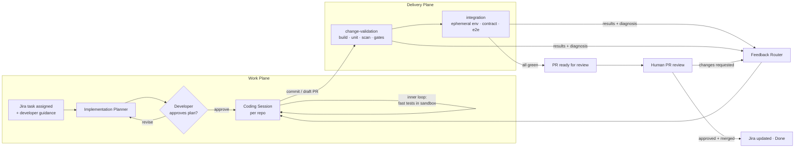
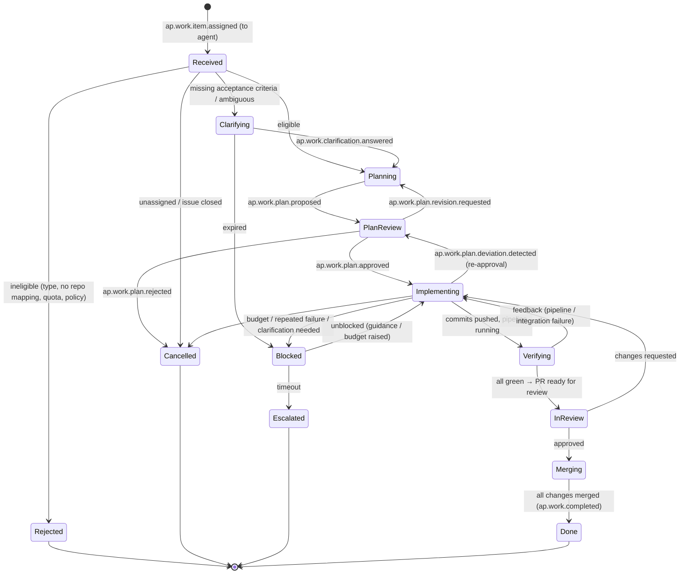

# 14 — Work Plane: From Task to Merged Change

> The work plane turns an assigned work item (a Jira task) into reviewed, tested, merged code. A developer assigns the task and gives guidance. An agent writes an implementation plan, and **the developer approves it before any code is written**. Coding agents then work in the background in isolated sandboxes, writing code and tests and committing to an agent branch. The delivery plane ([02](02-architecture-overview.md), [06](06-pipeline-lifecycle.md), [12](12-build-process-events.md), [15](15-integration-testing.md)) verifies every commit. Its results are routed back to the coding agent until the change is green, reviewed and merged.

## 1. The two loops



- **Inner loop** (seconds to minutes). The coding agent compiles and runs targeted tests inside its own dev sandbox, using the repo's Build Plan to know *how*. This is cheap, fast and not authoritative.
- **Outer loop** (minutes). Every push goes through the full delivery pipeline: build, unit tests, scans, integration tests, gates. This is authoritative. Its typed failure events ([12](12-build-process-events.md)) come back to the *same* session as structured feedback.

## 2. Human touchpoints

The developer stays in control at three fixed points and is otherwise not interrupted.

| # | Touchpoint | Who | Required? | Channel |
|---|------------|-----|-----------|---------|
| 1 | **Assign and guide.** Assign the task to the agent and give direction (approach, constraints, files to look at, things to avoid). | Sponsoring developer | Assignment required; guidance strongly encouraged | Jira assignment + comment, console, CLI, Slack |
| 2 | **Approve the plan.** Review the implementation plan (repos, approach, files, tests to add, risks) and approve or request revisions. | Sponsoring developer (or a delegate on the owning team) | **Always required** ([ADR-0007](adr/0007-developer-approved-implementation-plan.md)) | Jira comment `/ap approve` / `/ap revise …`, console button |
| 3 | **Review the PR.** Normal code review of the agent's PR, with plan, test evidence and integration results attached. | Developer + CODEOWNERS | **Always required.** Agent-authored code is never auto-merged. | GitHub PR review |
| — | *Clarifications* (on demand) | Sponsoring developer | Only when the agent is blocked | Jira comment thread, Slack |
| — | *Escalations* (on demand) | Sponsoring developer / team | Budget, repeated failure, out-of-plan scope | Jira + notification |

**Sponsoring developer.** The person who assigned the task to the agent (or who is named by `/ap sponsor @user`). They own the outcome: they approve the plan, answer clarifications, are the default PR reviewer, and are accountable for the merge.

## 3. Work item lifecycle

One durable workflow per work item (H-WRK-03), keyed by `wi-<tenant>-<ISSUE-KEY>`.



**Plan invalidation.** If the work item's description or acceptance criteria change after approval (`ap.work.item.updated` with relevant fields), the plan is marked `superseded`, active sessions pause, and a re-plan or re-approval is requested. The developer can choose to "keep the current plan".

## 4. Intake

### 4.1 Triggers (configurable per Jira project)

| Trigger | Default |
|---------|---------|
| Assignee changes to the agent user (`pipeline-agent`) | ✓ |
| Status transitions to a configured status (e.g. `Ready for Agent`) | opt-in |
| Label `ap-agent` added | opt-in |
| `/ap start` comment by an authorised user | ✓ |
| Console / CLI `ap work start ACME-1234` | ✓ |

### 4.2 Eligibility (Work Intake Router, H-WRK-01)

These checks are deterministic, and their results are recorded as `ap.work.request.accepted` / `rejected`:

- The issue type is allowed (e.g. Story, Task, Bug; not Epic).
- The issuing user is mapped to a GitHub identity and belongs to a team that owns at least one candidate repo.
- **Repo resolution** (H-WRK-04): Jira component → repo mapping, labels, the service catalog, links to previous PRs. Unresolvable ⇒ clarification.
- Quotas and budget: the team has concurrent-session and monthly agent-spend headroom.
- Policy: the project is enabled, and the task is not labelled `security-sensitive` (configurable).

### 4.3 What the agent reads

| Input | Trust | Notes |
|-------|-------|-------|
| Summary, description, acceptance criteria | Untrusted context | Wrapped as data ([09](09-security-and-trust.md)) |
| Guidance from the **sponsoring developer** or owning-team members | **Trusted instruction** | Only these authors' comments become `ap.work.guidance.provided` |
| Comments from anyone else | Untrusted context | Visible to the agent as information, never as instructions |
| Linked issues, epics, parent | Untrusted context | |
| Attachments | Untrusted, size-limited | Images / text only |
| Repo code, docs, ADRs, history | Untrusted context | Via the read-only checkout |
| Repo profile + Build Plan | Platform-trusted | Tells the agent how to build and test |

## 5. Implementation plan (what the developer approves)

The Implementation Planner agent produces a **versioned, structured plan**. It is rendered in Jira (comment and attachment) and the console. Approval is bound to a specific `planId@version` digest, so editing it means re-approval.

```yaml
planId: ipl_01JD7…
version: 2
workItem: ACME-1234
summary: >
  Add idempotency keys to refund API so retried client requests don't double-refund.
approach:
  - Accept an `Idempotency-Key` header on POST /refunds.
  - Store key → response in a new `refund_idempotency` table (24h TTL).
  - Return the stored response on replay; 409 on same key with a different body.
repos:
  - repo: acme/payments-api
    changes:
      - path: src/main/java/.../RefundController.java     # modify
      - path: src/main/java/.../IdempotencyStore.java     # new
      - path: src/main/resources/db/migration/V42__refund_idempotency.sql   # new
  - repo: acme/payments-client-ts
    changes:
      - path: src/refunds.ts                               # send header automatically
tests:
  unit:
    - IdempotencyStoreTest: stores, expires, conflicts
  integration:
    - "POST /refunds twice with same key returns identical response (ephemeral env, real Postgres)"
    - "Different body with same key returns 409"
  contract:
    - payments-client-ts ↔ payments-api: header present
acceptanceCriteriaMapping:
  AC1: [integration#1]
  AC2: [integration#2]
outOfScope: [Admin UI changes, backfilling historical refunds]
risks:
  - DB migration on a hot table — new table only, no ALTER on refunds.
openQuestions: []          # if non-empty, plan cannot be approved until answered
estimates: { sessions: 2, iterations: "3–6", cost: { amount: "4.50", currency: USD }, wallclock: "45m" }
scopeEnvelope:              # enforced by the Scope Guard (H-WRK-08)
  repos: [acme/payments-api, acme/payments-client-ts]
  pathGlobs:
    acme/payments-api: ["src/**", "src/main/resources/db/migration/**", "src/test/**"]
    acme/payments-client-ts: ["src/**", "test/**"]
  forbidden: [".github/**", ".agentic/**", "CODEOWNERS", "**/secrets/**"]
```

**Approval rules**
- Approver: the sponsoring developer, or a member of the owning team if delegated. The agent identity can never approve.
- Approval is recorded as `ap.work.plan.approved{planId, version, digest, approver}`, and `ap.approval.*` records it in the general audit.
- Revisions: `/ap revise <feedback>` creates a new plan version. The full revision history is kept.
- Unanswered `openQuestions` block approval.
- Expiry: an unapproved plan expires after a configurable period (default 5 business days), and the work item returns to the sponsor.

## 6. Coding sessions

An approved plan produces **one coding session per repo** (`ap.devsession.requested`). Sessions in a multi-repo plan run in parallel and are grouped into a **changeset** ([15 §5](15-integration-testing.md#5-multi-repo-changesets)).

### 6.1 Session loop

```mermaid
sequenceDiagram
  autonumber
  participant SO as Session Orchestrator (H-WRK-06)
  participant SB as Dev Sandbox
  participant TA as Test Author agent
  participant CA as Coding agent
  participant SG as Scope Guard
  participant AP as Applier
  participant GH as GitHub
  participant DP as Delivery pipeline
  participant FR as Feedback Router

  SO->>SB: provision (checkout, toolchain from Build Plan, no secrets)
  SO->>TA: write tests from plan + acceptance criteria
  TA-->>SO: proposal(kind=commit, tests only)
  SO->>CA: implement plan until the new tests pass
  loop inner loop
    CA->>SB: edit · build · run targeted tests
  end
  CA-->>SO: proposal(kind=commit, code + tests)
  SO->>SG: within approved scope envelope?
  SG-->>SO: ok
  SO->>AP: apply commit to branch ap/ACME-1234/payments-api
  AP->>GH: push; open DRAFT PR (first push)
  GH-->>DP: ap.change.opened / updated → change-validation → integration
  DP-->>FR: run.completed, diagnosis, integration results
  FR-->>SO: ap.devsession.feedback.received
  alt failure
    SO->>CA: iterate with structured feedback
  else all green
    SO->>GH: mark PR ready for review, request sponsor + CODEOWNERS
  end
```

### 6.2 Test-first, with independent test authorship

Tests are written **before** the implementation, by a separate agent instance (the **Test Author**). It works from the approved plan's `tests` section and the acceptance criteria, not from the implementation. That stops the coding agent from writing tests that just confirm its own code. The coding agent may *add* tests. It may not weaken or delete tests written by the Test Author without a plan deviation and re-approval. The Scope Guard checks this by diffing assertions in test files.

### 6.3 Commits and PRs

| Convention | Value |
|------------|-------|
| Branch | `ap/<ISSUE-KEY>/<repo-slug>` (agent-owned; branch protection lets only the agentic-pipeline App push) |
| Commit trailers | `Ap-Work-Item: ACME-1234`, `Ap-Session-Id: ses_…`, `Ap-Plan: ipl_…@2`, `Ap-Proposal-Id: prp_…`, `Co-authored-by: <sponsor>` |
| Commit granularity | Logical commits (tests, implementation, migration), not one commit per iteration. Iterations are amended or squashed before review. |
| PR state | **Draft** while implementing (pipeline still runs: `draftBuilds` is forced on for agent changes). **Ready for review** only when all gates and integration tests pass. |
| PR body | Links to the Jira issue and approved plan, a summary of changes per plan item, an acceptance-criteria → test mapping with results, integration environment results, iterations and cost, known limitations |
| Reviewers | Sponsor + CODEOWNERS (auto-requested at ready-for-review) |
| Merge | Human only. Branch protection requires ≥ 1 human approval on any PR with the `ap-agent-authored` label. |

### 6.4 Feedback routing (H-WRK-07)

The Feedback Router decides **where pipeline and review feedback goes**:

| Feedback event | On a change owned by an active session | On a human change |
|----------------|----------------------------------------|-------------------|
| `ap.diagnosis.completed` (any class) | → `ap.devsession.feedback.received{source=pipeline}` | → Remediator (H-DIAG-05) as before |
| `ap.integration.suite.completed{failure}` + `ap.integration.failure.attributed` | → owning session(s) of the attributed repo(s) | → notify author |
| `ap.gate.evaluated{fail}` | → session | → Reporter only |
| `ap.change.review.submitted{changes_requested}` | → session (review comments as **trusted guidance** if from sponsor/CODEOWNERS) | — |
| `ap.change.comment.created` from sponsor on the PR | → session as guidance | — |
| `ap.work.guidance.provided` (mid-flight) | → session(s) | — |
| `infra`-class diagnosis | **Not** sent to the session. The Retry Controller handles it. The agent must not "fix" infrastructure flakiness in code. | same |
| `test-flaky` on a test not touched by the session | Not sent to the session. Quarantine flow. | same |

Feedback payloads are **structured**: typed failure events, file and line locations, log windows, and the diff of the failing commit. Never "the job failed, here's 40 MB of log".

### 6.5 Stopping conditions

A session stops and raises `ap.devsession.blocked` / `ap.agent.escalated` when any of these happen:

| Condition | Default |
|-----------|---------|
| Iterations without progress (same failure signature twice in a row) | 2 |
| Total outer-loop iterations | 8 |
| Session cost | 3× the plan estimate, or a team cap |
| Wall-clock | 4 h active |
| Plan deviation needed (file outside the envelope, new repo, changed approach, test weakening) | immediately → re-approval |
| Clarification needed | immediately → question to the sponsor, session paused |
| Guardrail triggered | immediately → security escalation |

The escalation always includes a summary: what was tried, current state, the specific blocker, and a suggested next step.

## 7. Jira write-back (Work Reporter, H-WRK-10)

| Platform event | Jira effect |
|----------------|-------------|
| `ap.work.request.accepted` | Comment "Picked up — planning", optional transition → `In Progress` |
| `ap.work.request.rejected` | Comment with reason, reassign to the sponsor |
| `ap.work.clarification.requested` | Comment mentioning the sponsor with numbered questions |
| `ap.work.plan.proposed` | Plan comment + attachment, transition → `Plan Review` (if configured) |
| `ap.work.plan.approved` | Comment confirming the version |
| `ap.devsession.change.opened` | Remote link to the PR (dev panel through the GitHub-for-Jira integration also works) |
| `ap.devsession.blocked` / `ap.agent.escalated` | Comment + flag, mention the sponsor |
| PR ready for review | Comment with summary + test evidence, transition → `In Review` |
| `ap.work.completed{merged}` | Final summary (changes, tests, cost), transition → `Done` (or `Ready for Release`) |

Jira custom fields (optional): `Agent Status`, `Agent Cost`, `Plan Version`, `Sessions`.

## 8. Work-plane events

The full catalog is in [04 §work-plane](04-event-catalog.md#work-plane-domains) and the machine-readable [`catalog/work-events.yaml`](catalog/work-events.yaml). Summary:

| Domain | Events |
|--------|--------|
| `work.item` | `assigned`, `unassigned`, `transitioned`, `updated`, `commented`, `linked`, `deleted` |
| `work.request` | `received` (I), `accepted`, `rejected` |
| `work.guidance` / `work.clarification` | `guidance.provided`, `clarification.requested` (I), `clarification.answered`, `clarification.expired` |
| `work.repos` | `resolved` |
| `work.plan` | `requested` (I), `proposed`, `revision.requested`, `approved`, `rejected`, `superseded`, `expired`, `deviation.detected` |
| `work` | `blocked`, `unblocked`, `completed`, `cancelled` |
| `devsession` | `requested` (I), `started`, `checkpoint`, `inner_loop.completed`, `commit.pushed`, `change.opened`, `feedback.received`, `iteration.started`, `ready_for_review`, `blocked`, `resumed`, `completed`, `cancelled` |
| `changeset` | `created`, `member.updated`, `ready`, `merge.requested` (I), `merged`, `partially_merged` |

## 9. Correlation

The work item is the **root correlation** (`wi-<tenant>-<ISSUE-KEY>`). Each change's correlation (`chg-…`) carries `links: [wi-…]`. Every run, diagnosis, integration environment, agent task and deployment can therefore be rolled up to the Jira task, and this gives:

- **Cost per ticket** (agent tokens + compute + environments)
- **Ticket lead time** (assigned → plan approved → first green → merged → deployed)
- **Agent effectiveness**: plan approval on the first version, iterations to green, review rounds, post-merge revert rate, human edit ratio on agent PRs

## 10. Metrics (H-PRJ-10, H-PRJ-11)

| Metric | Why it matters |
|--------|----------------|
| Plan first-pass approval rate | Planner quality; guidance quality |
| Time in `PlanReview` | The developer bottleneck; nudge if high |
| Outer-loop iterations to green (p50/p90) | Coding agent quality, inner-loop effectiveness |
| Inner-loop → outer-loop escape rate | How often local tests pass but the pipeline fails (env parity) |
| Review rounds per agent PR | Code quality as humans see it |
| Escalation rate by reason | Where agents get stuck |
| Revert / hotfix rate within 14 d of merge | True quality |
| Cost per merged ticket, by team and issue type | ROI |
