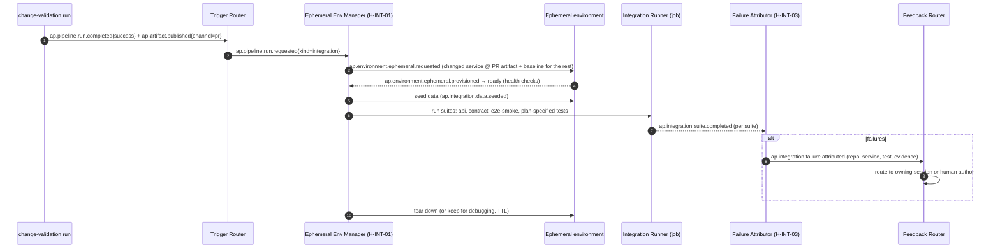
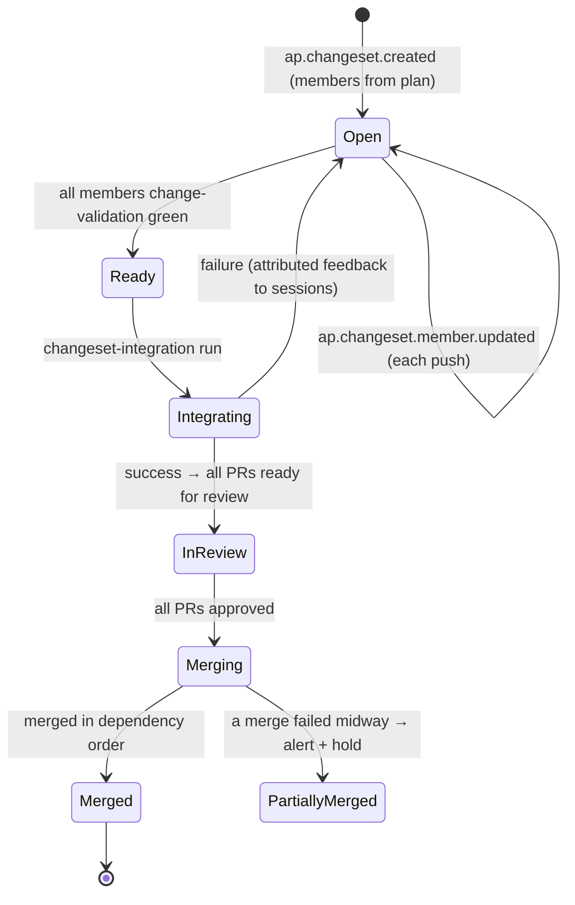

# 15 — Integration Testing

> Unit tests prove the agent's code does what the agent thinks. Integration tests prove it works **with everything else**: real databases, real dependent services, real contracts, and the other repos changed for the same work item. For agent-authored changes, integration testing is the main defence against plausible but wrong code. It is a first-class pipeline stage, not an optional extra.

## 1. Test levels and where they run

| Level | What it proves | Where | Pipeline kind / phase | Events |
|-------|----------------|-------|-----------------------|--------|
| Unit | Logic in isolation | Build job | `change-validation` · phase J | `ap.build.test.suite.completed{level=unit}` |
| In-job integration | Code + real infra dependencies (DB, broker) via containers | Build job (testcontainers / services) | `change-validation` · phase J | `ap.build.test.services.*`, `…suite.completed{level=integration}` |
| Contract | Producer/consumer API compatibility | Build job + contract broker | `change-validation` · phase J | `ap.build.test.contract.verified` |
| **Service integration** | The changed service deployed and talking to its real neighbours | **Ephemeral environment** | **`integration`** | `ap.environment.ephemeral.*`, `ap.integration.suite.*` |
| **Changeset integration** | All repos changed for one work item, deployed together | **Ephemeral environment** | **`changeset-integration`** | + `ap.changeset.*` |
| E2E smoke | Critical user journeys still work | Ephemeral environment | `integration` (smoke suite) | `ap.integration.suite.completed{suite=e2e-smoke}` |
| Post-deploy verification | Works in a real environment | dev/staging | `deploy` | `ap.deployment.*`, `ap.environment.health.*` |

## 2. Integration pipeline flow



**When it runs**
- Automatically after a successful `change-validation` on any change whose repo declares `integration:` in its manifest.
- **Always** for agent-authored changes in repos with an integration config. A PR does not become *ready for review* until integration passes.
- For a multi-repo work item: once every member change is individually green, run `changeset-integration` ([§5](#5-multi-repo-changesets)).
- On demand: `/ap integration` (PR comment) or `ap.command.received{integration}`.

## 3. Ephemeral environments

### 3.1 Strategies (chosen per repo or system)

| Strategy | How | Cost | Fidelity | Use when |
|----------|-----|------|----------|----------|
| **Full stack** | Namespace per change with all services of the system at baseline versions, plus the changed ones | High | Highest | Small/medium systems, before release |
| **Baseline + overlay** (default) | A shared, continuously updated baseline environment. Only the changed services are deployed in an isolated overlay, and test traffic is routed to the overlay by request header (service mesh). | Low | High for request-path changes | Large microservice estates |
| **Compose-in-job** | `docker compose` / kind cluster inside a large executor | Low | Medium | Libraries, small services, no cluster needed |
| **Simulated neighbours** | Changed service + recorded or contract-generated stubs | Lowest | Lower | External or third-party dependencies |

### 3.2 Environment spec (resolved from manifest + changeset)

```yaml
environment:
  strategy: baseline-overlay
  system: payments                  # service-catalog system
  ttl: 2h                           # torn down after; extended while a session is active
  services:
    - name: payments-api
      artifact: ghcr.io/acme/payments-api@sha256:…   # from the PR build
    - name: payments-client-ts
      artifact: npm:@acme/payments-client@0.0.0-pr881.3
  baselineFrom: mainline            # everything else = latest green mainline
  data:
    strategy: db-branch             # db-branch | seed-fixtures | masked-snapshot
    seed: tests/integration/seed.sql
  secrets: integration-only         # synthetic credentials, never prod
  egress: [sandbox-payment-provider.example.com]
```

### 3.3 Test data

| Strategy | Notes |
|----------|-------|
| **Database branching** (copy-on-write branch of a baseline DB) | Fast, realistic, isolated per environment. Preferred for Postgres-backed services. Migrations from the change run on the branch, so **migrations are tested too**. |
| Seed fixtures | Deterministic, small. Defined in the repo, and the agent may add fixtures within the plan. |
| Masked snapshot | Production-like volume with PII removed. Opt-in, refreshed on a schedule. |

**Never** production data or production credentials. Environment identities are scoped to the environment namespace.

### 3.4 Lifecycle and cost

- Created on demand. Destroyed on success after results are uploaded. Kept on failure for `ttl` so the coding agent (read-only, through tools) or a human can debug it.
- A per-team cap on concurrent environments. Requests over the cap queue at the work item's priority.
- The Env Reaper (H-INT-04) enforces TTLs and cleans up orphans (`ap.environment.ephemeral.torn_down{reason=ttl|orphan}`).
- Cost is attributed per environment to the work item's correlation.

## 4. Failure attribution

Integration failures in a multi-service environment are ambiguous. "Checkout e2e failed" could be the changed service, a baseline service, test data, or a flaky environment. The **Failure Attributor** (H-INT-03) decides first, using deterministic signals, and asks the Diagnoser agent only when those are inconclusive:

| Signal | Attribution |
|--------|-------------|
| Same suite fails against pure baseline (control run) | Baseline / environment issue → not the change. Retry or alert the system owner. |
| Error originates in a changed service (trace spans, logs by service) | That service's repo / session |
| Contract verification failure | Producer or consumer per contract-broker result |
| Migration failed on DB branch | The repo that owns the migration |
| Environment never became healthy | `infra` → retry, not sent to sessions |
| Test only touched by the change fails | The change |

Output: `ap.integration.failure.attributed{repos[], services[], testIds[], confidence, evidenceRefs[]}`. The Feedback Router uses it to send feedback **only to the responsible session(s)**.

> **Control runs.** For flaky-prone suites, the runner can execute the failing tests against the baseline in parallel. This is the most reliable way to tell "my change broke it" from "it was already broken", and it stops agents chasing failures they did not cause.

## 5. Multi-repo changesets

When an approved plan spans several repos, the Changeset Coordinator (H-WRK-09) groups the member changes:



- **Merge order** is derived from the dependency graph (H-PRJ-09): producers before consumers, libraries before services, schema/migrations before code that needs them. Merges go through each repo's merge queue.
- **Version pinning**: a consumer's PR temporarily depends on the producer's PR prerelease artifact (`0.0.0-pr881.3`). After the producer merges, the coordinator updates the consumer's PR to the released version and re-verifies.
- **Partial merge** (`ap.changeset.partially_merged`) is a held state. The coordinator never leaves mainline inconsistent silently. It escalates with options: complete, revert the merged member, or proceed manually.

## 6. Integration tests written by agents

- The approved plan lists the required integration tests, mapped to acceptance criteria ([14 §5](14-work-plane.md#5-implementation-plan-what-the-developer-approves)).
- The **Test Author** writes them in the repo's existing integration test framework (detected by the Profiler: e.g. RestAssured, pytest + httpx, Playwright, Supertest, Pact).
- The PR body shows the acceptance-criteria → test → result mapping. A missing mapping blocks ready-for-review.
- The coding agent can read integration results and environment logs through tools, but **cannot** modify baseline services or shared fixtures outside its plan envelope.

## 7. Manifest additions

```yaml
integration:
  system: payments
  strategy: baseline-overlay
  suites:
    - name: api
      command: ./gradlew integrationTest -Penv.url=$AP_ENV_URL
      reports: [{ kind: junit, path: "build/test-results/integrationTest/*.xml" }]
    - name: e2e-smoke
      command: npx playwright test --project=smoke
      required: true
  contracts:
    broker: pact
    role: provider
  data:
    strategy: db-branch
    seed: src/test/resources/integration-seed.sql
  ttl: 2h
  requiredFor: [agent-authored, label:needs-integration]   # or [all]
```

## 8. Events (summary)

The full catalog is in [04 §integration](04-event-catalog.md#environmentephemeral--integration--l2--l3) and [`catalog/work-events.yaml`](catalog/work-events.yaml).

| Type | Class | Key data |
|------|-------|----------|
| `ap.environment.ephemeral.requested.v1` | I | `envSpecRef`, `strategy`, `services[]`, `ttl`, `correlation` |
| `ap.environment.ephemeral.provisioned.v1` | F | `envId`, `url`, `services[]{name,digest,version}`, `provisionMs` |
| `ap.environment.ephemeral.provision.failed.v1` | F | `reason` (`capacity`, `image`, `migration`, `health-timeout`, `quota`) |
| `ap.environment.ephemeral.ready.v1` | F | `envId`, `healthChecks[]` |
| `ap.environment.ephemeral.torn_down.v1` | F | `envId`, `reason` (`completed`, `ttl`, `orphan`, `cancelled`), `lifetimeMs`, `cost` |
| `ap.integration.data.seeded.v1` | F | `envId`, `strategy`, `datasets[]`, `migrationsApplied[]` |
| `ap.integration.suite.started.v1` | F (T) | `envId`, `suite` |
| `ap.integration.suite.completed.v1` | F (S) | `envId`, `suite`, `passed`, `failed`, `skipped`, `durationMs`, `reportRef`, `controlRun?` |
| `ap.integration.failure.attributed.v1` | F | `repos[]`, `services[]`, `testIds[]`, `class`, `confidence`, `evidenceRefs[]` |
| `ap.changeset.*` | — | see [14 §8](14-work-plane.md#8-work-plane-events) |
