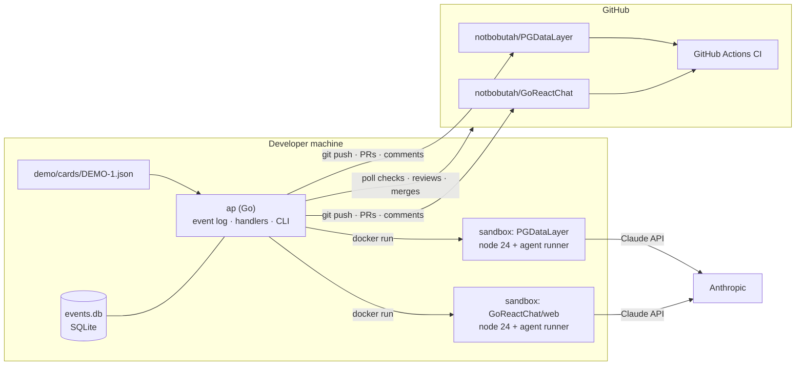

# Demo: Two Repos, One Card

> A thin vertical slice of the design ([14](../14-work-plane.md), [15](../15-integration-testing.md), [03](../03-event-model.md)) running end to end against real GitHub repos. A local card stands in for a Jira task. Agents plan; a developer approves; agents write code and tests in two repos; GitHub Actions verifies; feedback loops back; both PRs end ready for review.
>
> The point is the **process automation**, not the app. Nothing is deployed, but everything is **built and tested**, because without checks that can fail there is no feedback loop to demonstrate.

## 1. What the demo proves

| # | Capability | Design reference | How it shows up |
|---|------------|------------------|-----------------|
| 1 | Work intake from a tracker card | 14 §4 | `ap card submit DEMO-1.json` → `ap.work.item.assigned` → eligibility + repo resolution |
| 2 | **Developer-approved implementation plan** | 14 §5, ADR-0007 | Plan v1 shown; `ap revise` → v2; `ap approve` binds to the v2 digest |
| 3 | Scope envelope enforcement | 14 §6, 09 §2.1 | A commit touching a path outside the envelope is blocked → `ap.work.plan.deviation.detected` |
| 4 | Test-first, independent Test Author | 14 §6.2 | Tests commit lands before the implementation commit in each repo |
| 5 | Two parallel coding sessions | 14 §6 | One session per repo, separate sandboxes and branches |
| 6 | Outer loop with **structured** feedback | ADR-0008 | A red CI check → classified diagnosis → `ap.devsession.feedback.received` → fix commit |
| 7 | Multi-repo changeset + version pinning | 15 §5 | The frontend PR pins `pgdatalayer` to the data PR's head SHA. After the data PR merges, the pin moves to the merged SHA. |
| 8 | Integration check without deployment | 15 §3.1 (compose-in-job) | The frontend CI builds and tests against the exact PGDataLayer SHA from the same changeset |
| 9 | Everything is an event | 03 | `ap timeline DEMO-1` renders the correlated event tree, from card to PRs |

## 2. Topology



| Component | Design equivalent | Demo implementation |
|-----------|-------------------|---------------------|
| Event bus + store | Kafka + event store (ADR-0002) | **SQLite append-only `events` table** + in-process dispatcher. The CloudEvents envelope is unchanged. |
| Schema gate | Schema registry | Publish is rejected unless the type is in `demo/catalog.yaml` |
| Durable workflows | Temporal (ADR-0003) | Work items and sessions are **event-sourced state machines**, rebuilt from the log on restart |
| Policy engine | OPA | Plain Go functions; every decision is still emitted as `ap.policy.decision.recorded` |
| Executors | microVM executors | **GitHub Actions is the executor.** Its check runs are mapped to `ap.pipeline.run.*` / `ap.pipeline.job.*`. |
| Ingestion | Webhooks + reconciler | **Polling only** (the reconciler path): check runs, reviews, merges every 15 s. No tunnel needed. |
| Jira | Jira Cloud app | Local card file in. The Work Reporter writes "Jira comments" to `demo/cards/DEMO-1.activity.md` and the console. |
| Agent runtime | Agent Gateway | Go launches one Docker container per agent task. A **TypeScript runner using the Claude Agent SDK** runs inside it (there is no Go Agent SDK). |
| Applier | Deterministic Applier | Go, on the host: Scope Guard → `git commit` with trailers → push. **The sandbox never holds a GitHub token.** |
| Identity | GitHub App bot | `RobatDE` (collaborator). Commits carry the `Ap-*` trailers, and PRs are labelled `ap-agent-authored`. |

## 3. Agent runner contract

Each agent task is a container run: `docker run --rm -v <workdir>:/work -e ANTHROPIC_* ap-sandbox:node24 ap-runner /work/task.json`.

| File | Direction | Content |
|------|-----------|---------|
| `/work/task.json` | in | `{ role: implementation-planner \| test-author \| coding, workItem, plan?, feedback?, repoDir, allowedPaths[], budget: {maxTurns, usd}, model }` |
| `/work/repo/` | in/out | Writable clone (coding/test roles) or read-only clone (planner) |
| stdout (JSONL) | out | Progress lines → `ap.devsession.checkpoint` / `ap.devsession.inner_loop.completed` |
| `/work/result.json` | out | Structured result validated by Go: the plan (planner role), or `{summary, commitMessage, testsRun, testsPassed}` (coding roles) |

**Runner rules**
- Tools: file read/write/edit, glob/grep, and shell **restricted to** `npm`, `npx`, `node`, `git status|diff|log` (no `git push`, no `curl`). Planner: read-only tools.
- Model: `claude-opus-5-5`. A turn and cost budget is set per role.
- The sandbox runs `npm ci` before the agent starts. `web/AGENTS.md` tells agents to read the Next.js 16 docs in `node_modules/next/dist/docs/`, and the coding prompt carries that through.
- Untrusted-context wrapping for card text and repo content. Sponsor guidance is passed as instructions.
- Egress (best effort for the demo): Anthropic API, npm registry, GitHub (for the `github:` npm dependency).

Exact Agent SDK options (tool allow-lists, max turns, structured output) are taken from the Agent SDK docs when the runner is built.

## 4. The card

`demo/cards/DEMO-1.json`:

```json
{
  "key": "DEMO-1",
  "issueType": "Story",
  "summary": "Product catalog demo page backed by PGDataLayer",
  "assignee": "pipeline-agent",
  "sponsor": "rob",
  "components": ["data", "web"],
  "description": "Create a small faux product catalog as a data package and show it on a new page in the GoReactChat web app.",
  "acceptanceCriteria": [
    "AC1: PGDataLayer defines JSON Schemas for category and product, with ~25 faux products across 5 categories as JSON files.",
    "AC2: PGDataLayer CI validates every data file against its schema and fails on a product whose categoryId does not exist.",
    "AC3: PGDataLayer ships committed TypeScript types generated from the schemas, and CI fails if they are out of date.",
    "AC4: GoReactChat web has a /catalog page listing products grouped by category, using the typed data from the pgdatalayer package.",
    "AC5: GoReactChat web builds and its tests pass against the PGDataLayer commit from the same change."
  ],
  "guidance": [
    "Data is consumed at build time as an npm package installed from GitHub at a full commit SHA. No API, no Postgres.",
    "PGDataLayer must not have a prepare/build script; commit generated files.",
    "Reuse the existing Tailwind styling in web/. Do not touch the Go server or the chat page."
  ]
}
```

`demo/config.yaml` maps components to repos and scope envelopes:

```yaml
components:
  data: { repo: notbobutah/PGDataLayer, paths: ["**"], forbidden: [".github/**", ".agentic/**"] }
  web:  { repo: notbobutah/GoReactChat, paths: ["web/**"], forbidden: [".github/**", ".agentic/**", "server/**", "deploy/**"] }
dependencyOrder: [data, web]      # producer first → merge order and version pinning
```

## 5. Event subset (`demo/catalog.yaml`)

About 45 of the ~245 catalogued types are needed.

| Domain | Types |
|--------|-------|
| work | `item.assigned`, `request.received`, `request.accepted`, `request.rejected`, `guidance.provided`, `repos.resolved`, `plan.requested`, `plan.proposed`, `plan.revision.requested`, `plan.approved`, `plan.rejected`, `plan.deviation.detected`, `blocked`, `completed`, `cancelled` |
| devsession | `requested`, `started`, `checkpoint`, `inner_loop.completed`, `commit.pushed`, `change.opened`, `feedback.received`, `iteration.started`, `ready_for_review`, `blocked`, `completed` |
| changeset | `created`, `member.updated`, `ready`, `merged` |
| change (polled) | `change.opened`, `change.updated`, `change.review.submitted`, `change.merged` |
| pipeline (polled from Actions) | `pipeline.run.completed`, `pipeline.job.completed` |
| diagnosis | `diagnosis.completed` (rules on job name + log excerpt; the Diagnoser agent as fallback) |
| agent | `agent.task.assigned`, `agent.proposal.created`, `agent.task.completed`, `agent.escalated` |
| policy | `policy.decision.recorded` |

## 6. CLI walkthrough (the demo script)

```bash
ap serve &                                   # dispatcher + GitHub poller
ap card submit demo/cards/DEMO-1.json        # → intake, repo resolution, planner runs
ap plan show DEMO-1                          # plan v1: approach, files, tests ↔ ACs, envelope, estimate
ap revise DEMO-1 "group products by category on the page, not a flat table"
ap plan show DEMO-1 --diff                   # v1 → v2
ap approve DEMO-1                            # binds approval to plan v2 digest → 2 sessions start
ap status DEMO-1 --watch                     # sessions, iterations, PRs, check results
#   ... data PR green → frontend pinned to its SHA → frontend CI → (likely) red → feedback → fix → green
ap timeline DEMO-1                           # full correlated event tree
# Human: review + merge PGDataLayer PR → ap moves the frontend pin to the merged SHA → CI → ready
```

## 7. Repository setup (phase 0)

| Repo | Change | How |
|------|--------|-----|
| PGDataLayer | Seed commit: `README.md`, `package.json` (no deps, `exports` for `./data/*`, `./schema/*`, `./index.d.ts`, no `prepare`), `package-lock.json`, CI workflow (`npm ci` → `npm test` → `npm run check --if-present`), `.agentic/pipeline.yaml`, empty `data/` and `schema/` | Direct push to `main` (the repo is empty) |
| GoReactChat | `web-ci.yml` (paths `web/**`: `npm ci`, lint, `tsc --noEmit`, `npm test --if-present`, `next build`), `.agentic/pipeline.yaml` | **PR for you to merge.** Workflows are human-owned, and agents may not touch `.github/**`. |

Notes:
- The CI workflows call **repo scripts** (`npm test`, `npm run check`). The agents write the tests and validators those scripts run (AC2, AC3, AC5), so CI starts trivially green and becomes meaningful as agents add work.
- GoReactChat's existing `publish image` workflow also runs on PRs and builds the Go backend. The Feedback Router treats checks outside the change's affected project (`web`) as unrelated, so agents don't chase them.
- **Deployment is in scope** (approved 2026-11-20): the demo runs through merge, and the `/catalog` page may go live. As of 2026-11-20, though, GoReactChat's `publish image` and `deploy dev` workflows are **disabled** (`disabled_manually`, last run 2026-08-16). Until they are re-enabled, a merge runs only `web ci`. Once enabled, the poller maps the `deploy dev` run to `ap.deployment.completed`, which closes the work item.

## 8. Build phases

| Phase | Delivers | Done when |
|-------|----------|-----------|
| P0 Setup | Seed PGDataLayer; GoReactChat CI PR merged; `web` baseline verified green (lint, typecheck, build on current `main`) | Both repos have a green CI run on `main` |
| P1 Event core + intake + plan | Envelope, SQLite log, catalog gate, dispatcher, `ap card submit`, repo resolver, planner runner, `plan show/revise/approve`, activity file | Plan v2 approved, with the event tree visible in `ap timeline` |
| P2 Sessions + PRs | Sandbox image, runner (Test Author, Coding), Scope Guard, Applier, branches `ap/DEMO-1/<repo>`, draft PRs | Two draft PRs with tests-first commit history |
| P3 Feedback loop | Actions poller → pipeline events, rules classifier, Feedback Router, iteration and stop conditions | A red check produces a fix commit with no human input |
| P4 Changeset | Pinning the frontend to the data PR's SHA, joint readiness, ready-for-review, re-pin after the data merge | Both PRs ready for review; after the data merge, the frontend re-pins and goes green |
| P5 Polish | `ap timeline` rendering, cost per card, a recorded run | Repeatable 15-minute demo |

## 9. Code layout (in this repo)

```
cmd/ap/                 CLI + serve
internal/event/         envelope, UUIDv7, SQLite store, dispatcher, catalog gate
internal/work/          work item state machine, plan approval, repo resolver
internal/session/       session state machine, scope guard, applier (git)
internal/feedback/      feedback router, rules classifier
internal/changeset/     changeset coordinator, pin updates
internal/github/        poller (→ events), reporter (PRs, labels, comments, ready-for-review)
internal/agent/         gateway: docker launch, budgets, result validation
runner/                 TypeScript agent runner (Claude Agent SDK)
sandbox/Dockerfile      node:24 + git + runner
demo/                   cards/, config.yaml, catalog.yaml
```

## 10. Risks

| Risk | Mitigation |
|------|------------|
| `web` lint or build is already red on `main` | Verified in P0 (2026-11-20): lint ✓ and build ✓. Plain `tsc --noEmit` fails on the Next-generated `LayoutProps`, so `typecheck` = `next typegen && tsc --noEmit`, used by CI and the inner loop. |
| Next.js 16 API differences trip the agent | `npm ci` before the agent starts; the prompt points at the bundled Next docs (per `web/AGENTS.md`); the outer loop catches the rest |
| The loop never shows because the first attempt is green | Acceptable. AC2/AC3/AC5 make a first-pass miss likely. Never inject a fake failure. |
| Cost per run | Budgets per role. Planner and coding on `claude-opus-5-5`. Cost reported per card. |
| GitHub API rate limits from polling | 15 s interval, ETags, only tracked PRs; well under 5k/h |
| Credentials leaking into the sandbox | Only Anthropic credentials enter containers. GitHub writes happen on the host via the Applier. |
